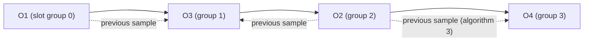

# ADR 0064: The YM3438 model follows the chip where ymfm differs, as Nuked-OPN2 has it (T7.7)

- **Status:** Accepted; closes the known differences of [ADR 0056](0056-ym3438-model.md#known-differences-from-the-chip)
- **Date:** 2026-10-31

## Context

[ADR 0056](0056-ym3438-model.md) made the FM model a bit-exact C# port of ymfm and listed four places where ymfm, and
so the port, differs from the chip as Nuked-OPN2 (a model built from the die) plays it: the order of the channel's
clipping sum, the SSG-EG blip on the alternating shapes, operators handled one slot at a time, and detune overflow
at the top of the range. Plan task T7.7 measures each against Nuked-OPN2, then fixes or records it. The project's goal
is the most accurate sound, so where the two disagree the chip wins over ymfm.

Measuring needed a closer look than the log-mel bars of ADR 0056: one-channel probes compared sample for sample with
Nuked (at its pipeline delay of 2–4 samples, within half a Nuked step) show a one-sample slip that a spectrum hides.
That comparison found four more differences, all in the envelope, and one in the reference tool's alignment.

## Decision

The port stays ymfm's code and structure, changed in eight places to do what Nuked-OPN2 does (David chose "read it,
write my own": the behavior was learned by reading Nuked's C and written anew in C#; no code was translated or copied).
Each place cites this ADR in a comment.

1. **The clipping sum in slot order** (`FmChannel.Output4Op`, `Ym3438.OutputClip`). The chip adds a channel's
   carriers in slot order, O1, O3, O2, O4, and clips to −256…255 after each one. ymfm starts from O4, adds O1, O2,
   O3 and clips to −257…256. With loud carriers the chip is up to 3 dB quieter.
2. **Operator 3 hears the previous sample** (`FmChannel.Output4Op`). The chip computes O1, O3, O2, O4 in that order
   and prepares each one's modulation before the slot before it is done, so O3 is modulated by O1 and O2 as they
   were a sample ago, and so is O4 by O2 in algorithm 3 (MAME's "MEM" delay). ymfm uses this sample's values.
   Every operator is now computed even when the channel is muted, so the delayed O2 keeps going.
3. **Operator 1 is keyed a sample late** (`FmChannel.KeyOnOff`, `FmEngine.Clock`). A key-on/off write reaches
   O2–O4 at the next sample and O1 one sample after, because the chip latches it into O1's slot on the next pass.
   ymfm keys all four at once. This is also what ADR 0056 took for detune overflow: at block 7, `$7FF` the port
   matches Nuked sample for sample once the key is late, and ymfm's and Nuked's detune tables are the same.
4. **The SSG-EG turn** (`FmOperator.Clock`, `EnvelopeAttenuation`). The sample whose attenuation reaches the
   midpoint already sounds with the inversion the turn will make; the turn itself (restart, hold) follows a sample
   later, and a phase reset (shapes 0 and 4) holds the phase at 0 for that sample. At the quiet end of the alternating
   shapes that is the full-level blip of ADR 0056, at the loud end a silent sample. A released note never inverts.
5. **The SSG-EG inverted hold keeps its overshoot** (`FmOperator.ClockSsgEgState`). In shapes 3 and 5 (decay once,
   then hold loud) the chip leaves the attenuation where its last step left it and inverts that: only a decay that
   stopped exactly on the midpoint (`$200`) holds at full level; one that stepped past it, as fast rates do (`$208`),
   wraps to near silence (`$3F8`). ymfm pins the attenuation to the midpoint, so it always holds loud.
6. **No envelope step in the key-on sample** (`FmOperator.ClockEnvelope`). The sample a key-on lands in only starts
   the attack; ymfm takes the first step at once when that sample is an envelope step.
7. **The envelope timer wraps from 4095 to 1** (`FmEngine.Clock`, `OpnRegisters.EgTimerBits`). The chip's envelope
   timer is 12 bits, and its adder feeds the carry straight back in, so it skips 0 when it wraps: every 4095 steps
   (about 0.23 s) the step pattern moves one step against ymfm's counter, which counts on. After the first wrap every
   envelope rate steps one tick off ymfm; sine's release was the sign of it.
8. **Fast rates step in Nuked's order** (`FmTables.IncrementTable`, rates 48–63). The larger steps of rates 4n+1,
   4n+2 and 4n+3 fall on counts 0 mod 4, even counts, and all but 3 mod 4; ymfm has the same steps in another order.

The reference tool's alignment is corrected too (`tools/ym3438-reference/reference.cpp`): its pre-roll now starts a
whole timer period plus two samples before the first sample, so Nuked's timer wraps on the first sample as the port's
counter leaves 0, and both step on the same samples. Plain decays at every rate then match sample for sample.

### Measured

Each probe against Nuked-OPN2: log-mel distance and the share of samples equal to Nuked's (one-channel probes; for
the others the share means little, as their channels start apart in Nuked). Five probes are new, one per difference:
`clip-order`, `modulation-order`, `ssg-shapes`, `top-note` and `envelope-rates`.

| Probe | ymfm dB | Port dB | Bar dB | ymfm same | Port same | Bar same |
|---|---|---|---|---|---|---|
| algorithms | 0.87 | 0.31 | 0.6 | 38.5 % | 99.4 % | 99 % |
| ch3-special | 0.94 | 0.10 | 0.6 | 4.2 % | 99.7 % | 99 % |
| clip-order | 1.73 | 0.18 | 0.6 | 1.8 % | 99.5 % | 99 % |
| detune-multiple | 2.76 | 2.84 | 3.0 | 16.8 % | 92.1 % | 90 % |
| envelope-rates | 0.11 | 0.04 | 0.6 | 95.2 % | 100 % | 99.9 % |
| feedback | 0.37 | 0.32 | 0.6 | 89.9 % | 96.6 % | 95 % |
| modulation-order | 0.89 | 0.06 | 0.6 | 24.1 % | 99.7 % | 99 % |
| sine | 0.03 | 0.02 | 0.6 | 98.1 % | 100 % | 99.9 % |
| ssg-eg | 2.87 | 0.07 | 0.6 | 85.0 % | 99.8 % | 99 % |
| ssg-shapes | 3.54 | 0.03 | 0.6 | 60.5 % | 100 % | 99.9 % |
| top-note | 0.07 | 0.07 | 0.6 | 99.7 % | 99.7 % | 99 % |
| write-quirks | 1.12 | 0.26 | 0.6 | 36.0 % | 91.6 % | 90 % |
| dac | 0.14 | 0.14 | 0.6 | | | |
| envelopes | 0.03 | 0.04 | 0.6 | | | |
| lfo | 0.51 | 0.51 | 0.6 | | | |
| six-channels | 3.51 | 1.91 | 2.2 | | | |

Each fix, turned off on its own, lowers the share of the probes it reaches (and changes no other probe):

| Fix | Probes it changes | Share without it |
|---|---|---|
| 1 clipping order | ch3-special, clip-order, detune-multiple, modulation-order, six-channels | clip-order 51 %, ch3-special 78 % |
| 2 operator 3 delayed | algorithms, modulation-order, write-quirks | modulation-order 25 %, algorithms 54 % |
| 3 operator 1 late | algorithms, ch3-special, clip-order, detune-multiple, feedback, lfo, modulation-order, six-channels, write-quirks | detune-multiple 19 %, ch3-special 25 % |
| 4 SSG-EG turn | ssg-eg, ssg-shapes | ssg-shapes 89 %, ssg-eg 90 % |
| 5 SSG-EG inverted hold | ssg-shapes | 78 % |
| 6 key-on step | envelope-rates | 96 % |
| 7 timer wrap | 13 of the 16 probes | ssg-shapes 74 %, sine 98 % |
| 8 fast-rate order | envelope-rates, ssg-shapes | ssg-shapes 63 % |

With all eight off the port plays every probe exactly as ymfm does. The tests keep both halves: the probes no fix
reaches (`dac`, `top-note`) must still equal ymfm, and each probe a fix reaches is listed under it and must come at
least as close to Nuked as ymfm does (tests/golden/ym3438/README.md).

### What is left

- **detune-multiple (2.84 dB):** Nuked's F-number writes land between samples, a few clocks apart; the model applies
  writes on sample boundaries. Its samples match 92 % (ymfm 17 %); the log-mel distance hardly moves because it is
  dominated by near-silent bands at the −80 dB floor.
- **six-channels (1.91 dB) and the other multi-channel probes:** the reference tool's setup writes take 25 clocks each
  in Nuked, so its channels start up to 170 samples apart; that is the tool, not the model.
- **Not modeled:** the per-slot timing of other register writes (a level or frequency change reaches each operator
  at its own slot), and the key-off sample's envelope step (Nuked steps once more with the old rate; tried, it made
  four probes worse, so it is not understood well enough to copy).

### On the corpus

The harness's `genesis` column on the 19 corpus songs (2026-10-31), before (main) and after: the mean log-mel
distance from libopenmpt goes from 11.54 to 11.53 dB (first 30 s: 11.85 to 11.84 dB); every song moves by at most
0.15 dB (most by 0.05 or less), and the onset F1 by at most 0.02. The scores compare with the MOD as OpenMPT plays it,
and the conversion's own differences (FM voices for samples, the PCM rate) dwarf these. What changes is detail: the
difference between the two renders is 15–48 dB below the mix, mostly above 4.5 kHz (the FM voices' brightness), most
on note starts and ends.

| Song | Before dB | After dB | Change |
|---|---|---|---|
| jam_-_xlr8 | 13.02 | 12.87 | −0.15 |
| drozerix_-_ai_renaissance | 16.43 | 16.48 | +0.05 |
| cancan | 10.57 | 10.54 | −0.03 |
| fx-poly1 | 6.64 | 6.66 | +0.02 |
| the other 15 | | | −0.01 to +0.01 |
| mean | 11.54 | 11.53 | −0.01 |

## Options considered

- **Model each difference in the port, learned from Nuked's behavior (chosen).** The sound moves to the chip; the
  port stays ymfm's code, so it can still be checked against ymfm wherever no difference reaches.
- **Translate Nuked-OPN2's code.** The most exact, but Nuked is LGPL-2.1 and a translation would be a derived work in
  a statically linked binary; and a cycle-by-cycle model is far slower than one sample at a time.
- **Keep ymfm and record the differences.** Simplest and still bit-exact with ymfm, but it keeps sounds the chip
  doesn't make (SSG-EG holds loud that the chip silences, clipping 3 dB too loud).
- **Model the key-off step too.** Measured worse on four probes; left out until it is understood.
- **Align the reference tool one more timer step (five samples).** It made sine match, but every plain decay worse:
  it hid the timer wrap rather than showing it.

## Consequences

- The port is no longer bit-exact with ymfm on 14 of the 16 probes; `Ym3438ProbeTests` lists, per fix, the probes it
  reaches, and checks the rest against ymfm as before. A new difference needs its own entry there.
- `THIRD-PARTY-NOTICES.md` says the eight behaviors were learned from Nuked-OPN2, with no code copied.
- The reference outputs (`*.nuked.gz`) were remade with the corrected alignment; the ymfm outputs didn't change.
- Every FM sound in the `genesis` renders changes a little: envelopes step on the chip's samples, loud chords clip
  lower, and SSG-EG shapes 3 and 5 at fast rates fall silent where they held loud.
- The model is not slower in any way that matters: no unbounded loops were added, and every probe renders within the tests'
  one-minute bound (David: slow is fine, stuck is not).
