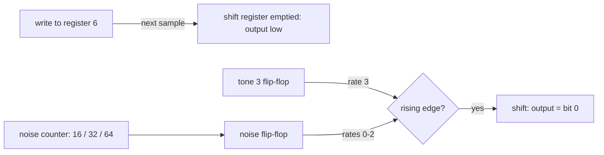

# ADR 0065: The SN76489 model's counters and noise follow the chip where MAME differs, as Nuked-PSG has them (T7.8)

- **Status:** Accepted; closes known differences 2 and 3 of [ADR 0057](0057-sn76489-model.md#known-differences-from-the-chip)
  and records 1 and 4
- **Date:** 2026-10-31

## Context

[ADR 0057](0057-sn76489-model.md) made the PSG model a bit-exact C# port of MAME's Sega PSG and listed four places
where MAME, and so the port, differs from the chip as Nuked-PSG (a gate-level model of the YM7101 VDP's PSG) plays
it: the volume levels at the quiet end, when a period change takes effect, the noise's timing, and the register the
latch points at after power-on. Plan task T7.8 measures each against Nuked-PSG, then fixes or records it. The goal is
the most accurate sound, so where the two disagree and the chip's behavior is known, the chip wins over MAME.

The probes were compared sample for sample as well as by log-mel distance. MAME's volume levels differ from
Nuked-PSG's at every volume but 0 and 15, so the share of equal samples was measured with Nuked's table swapped into
the port for the measurement only. With it, equal samples show a fix exactly, where a spectrum only hints at one.

## Decision

The port stays MAME's code and structure, changed in two places to do what Nuked-PSG does (David: "read it, write my
own", as for T7.7: the behavior was learned by reading Nuked's C and written anew in C#; no code was translated or
copied). Each place cites this ADR in a comment.

1. **The volume levels stay MAME's** (difference 1; David: measure first, decide later). MAME's levels are exact
   2 dB steps. Nuked's table falls off faster: 0.25 dB below MAME at volume 1, 0.75 dB at 5, 2.85 dB at 10 and
   12.9 dB at 14. Nuked-PSG's source (`ympsg.c`) and README at `d15a168` give no reference for the table, so its
   origin is still **Verify**. What it would change is measured below ([The volume levels](#the-volume-levels)).
2. **The counters count up to the period as it is now** (difference 2; `Sn76489.Generate`, `Write`). Each counter
   counts up from 1 and flips its flip-flop when the count reaches the period, compared with the period as it is
   now, then starts again. A shorter period written during a half-wave flips at once if the count is already past
   it; a longer one stretches the half-wave. The flip shows a sample after the count reaches the period. MAME loads
   the period into a down-counter when it flips, so a new period waits for the old one to run out: up to one
   half-wave late (4.6 ms at the lowest note), on every period change of a PSG vibrato or slide.
3. **The noise empties at once and shifts on its clock's rise** (difference 3; `Sn76489.Generate`, `Write`). The
   noise's own counter (period 16, 32 or 64) toggles a flip-flop like a tone's, and the shift register shifts on that
   flip-flop's rising edge, or on tone 3's at rate 3, so the noise is in step with tone 3. A write to the noise
   register empties the shift register on the next sample, so the output goes low at once, and no shift happens on
   that sample. The counter keeps running through a restart. MAME counts twice the period on a counter of its own
   (out of step with tone 3 after any change) and keeps the last bit until its next shift. The bits are the same:
   Nuked's empty register feeds a 1, the bit MAME loads into bit 15 on a restart.
4. **The power-on latch stays MAME's: register 3** (difference 4; David). Nuked-PSG sets the latch only on a write;
   it starts at 0 only because `YMPSG_Init` clears the whole state, not from any reset logic. MAME's register 3 comes
   from hardware tests credited in its source. Checking Nuked's source settles the ADR 0057 **Verify**: Nuked gives
   no evidence against MAME here. Songs always latch a register before writing data, so only the probe hears it.

### The power-on state

The chip clears its flip-flops on reset and then, with every period 0, flips them on every step until a period is
written. So where a tone stands at the first write depends on the time since reset, which nothing in a song controls.
The port starts where the reference tool's pre-roll leaves Nuked-PSG: every flip-flop high (the noise's too) and
every counter at 1. That is also how MAME's first step leaves a tone, so `tone` stays bit-exact with MAME.

### Measured

Each probe against Nuked-PSG: log-mel distance after averaging every four samples, as the tests measure it (the port
keeps MAME's volume levels), and the share of samples equal to Nuked's within 4, with Nuked's volume table swapped
in for this measurement only.

| Probe | MAME dB | Port dB | Bar dB (was) | MAME same | Port same |
|---|---|---|---|---|---|
| tone | 0.03 | 0.03 | 0.3 (0.3) | 100 % | 100 % |
| volumes | 2.07 | 2.07 | 2.5 (2.5) | 100 % | 100 % |
| periods | 0.89 | 0.10 | 0.3 (1.1) | 42 % | 100 % |
| chord | 0.84 | 0.72 | 0.9 (1.0) | 93 % | 99 % (100 % one sample off) |
| white-noise | 2.07 | 0.005 | 0.3 (2.5) | 66 % | 100 % |
| periodic-noise | 2.98 | 0.01 | 0.3 (3.5) | 90 % | 100 % |
| noise-restart | 1.90 | 1.90 | 2.3 (2.3) | 100 % | 100 % |
| write-quirks | 0.98 | 0.16 | 0.3 (1.2) | 86 % | 100 % |
| power-on-latch | 9.98 | 9.98 | 11.0 (11.0) | 77 % | 77 % |

The fixes on their own (port dB with only that fix):

| Fix | Probes it changes | dB with only this fix |
|---|---|---|
| 2 counters count up | periods, write-quirks | periods 0.10, write-quirks 0.34 |
| 3 noise timing | chord, white-noise, periodic-noise, write-quirks | chord 0.72, white-noise 0.74, periodic-noise 0.49, write-quirks 0.83 |

The noise probes need both: at rate 3 the noise follows tone 3's flip-flop, which fix 2 puts on the chip's samples.
Without the two fixes the port is the MAME port of ADR 0057, exact on every probe. The tests keep both halves: the probes no fix
reaches (`tone`, `volumes`, `noise-restart`, `power-on-latch`) must still equal MAME, and each probe a fix reaches
must play differently from MAME and come closer to Nuked than MAME does (tests/golden/sn76489/README.md).

### What is left

- **The volume levels** (difference 1, above): `volumes`, `noise-restart` and most of `chord`. With Nuked's table,
  `volumes` would measure 0.009 dB and `noise-restart` 0.003 dB.
- **chord, one sample off:** its 9 setup writes take 18 PSG clocks in Nuked-PSG, more than a sample, so the reference
  tool lands tone 1's period a sample before the port does. Shifted by that sample, the two match on every sample.
  That is the tool, not the model.
- **power-on-latch** (difference 4, above).

### The volume levels

What swapping Nuked's table into the port would change, for David's decision (not shipped):

| Probe | MAME levels dB | Nuked levels dB |
|---|---|---|
| volumes | 2.07 | 0.009 |
| noise-restart | 1.90 | 0.003 |
| chord | 0.72 | 0.64 |
| write-quirks | 0.16 | 0.02 |

On the corpus (the harness's `genesis` column, as below), Nuked's table makes the mean log-mel distance from
libopenmpt 0.02 dB worse (11.53 to 11.55 dB), most on `drozerix_-_the_hawks_claw` (+0.20 dB), `musix-cute-october`
(+0.07) and `cancan` (+0.03). That is not evidence against the table: the score compares with the MOD, and the DMF's
noise volumes are chosen for MAME's 2 dB steps, so quieter levels at the soft end move those drums further from the MOD.
Taking the table would mean choosing PSG volumes from it too.

### On the corpus

The harness's `genesis` column on the 19 corpus songs (2026-10-31, libopenmpt 0.7.3, no Furnace or DefleMask columns),
before (main) and after: the mean log-mel distance from libopenmpt stays at 11.53 dB, every song moves by 0.01 dB or
less, and no onset F1 moves. As in ADR 0064, the conversion's own differences dwarf the chip's. Seven songs render
exactly as before; in the other twelve (those whose drums or tones go to the PSG) the difference between the two renders
is 21–46 dB below the mix (`musix-omg-plz-help` −21, `hit` −22, `jam_-_latenightcoffee` −24, `10kdub` −46). Most of it is
noise drums starting a few samples apart, which a sample difference counts in full though it sounds the same.

## Options considered

- **Model each difference in the port, learned from Nuked's behavior (chosen for 2 and 3).** The sound moves to the
  chip; the port stays MAME's code, so it can still be checked against MAME wherever no difference reaches.
- **Translate Nuked-PSG's code.** The most exact, but Nuked is GPL-2.0+ (approved for the test tool only), and a
  clock-by-clock model is far slower than one sample at a time.
- **Keep MAME and record the differences.** Simplest and still bit-exact with MAME, but PSG vibrato and slides land
  up to a half-wave late and noise drums start out of step with the chip.
- **Take Nuked's volume table now.** It would close the largest remaining distances (`volumes`, `noise-restart`),
  but nobody knows where the table comes from, and quiet PSG notes and fades would drop by up to 13 dB. Measured and
  left to David.
- **Follow Nuked's power-on latch (register 0).** It would close `power-on-latch`, but Nuked's 0 comes from clearing
  its state, not from the chip; MAME's register 3 comes from hardware tests.
- **Start the port's flip-flops low, as the chip's reset leaves them.** Truer to the instant after reset, but no song
  writes at that instant, and it would put `tone` a half-wave off both MAME and Nuked-PSG.

## Consequences

- The port is no longer bit-exact with MAME on 5 of the 9 probes; `Sn76489ProbeTests` lists, per fix, the probes it
  reaches, and checks the rest against MAME as before. A new difference needs its own entry there.
- Four unit tests pin the new behavior (a shorter period flips at once, a longer one stretches the half-wave, a
  noise write silences the noise at once, rate 3 shifts on tone 3's rise); each fails on MAME's code.
- `THIRD-PARTY-NOTICES.md` says the two behaviors were learned from Nuked-PSG, with no code copied.
- The reference outputs (`*.mame.gz`, `*.nuked.gz`) did not change, and neither did the reference tool.
- PSG notes in the `genesis` renders change a little: period changes take effect on the chip's samples, and noise
  drums start in step with the chip.
- Open: the volume levels (David). If Nuked's table is taken, `volumes`, `noise-restart` and `chord` drop to the
  default bar and `VolumesPlayMamesLevelsNegated` changes with them.
