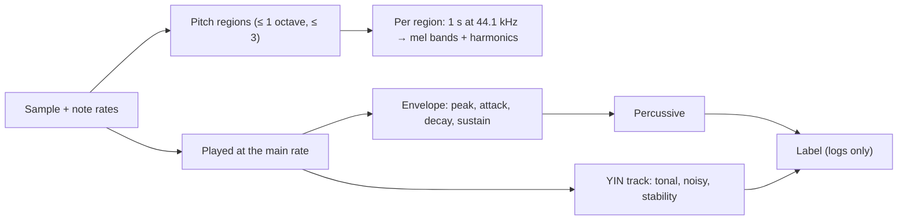

# ADR 0068: Sample analysis: three scores, pitch stability, envelope, loop and a spectrum per pitch region (T8.1)

- **Status:** Accepted
- **Date:** 2026-10-31

## Context

Plan task T8.1 is pass 2 of the [multi-pass optimizer](../multi-pass.md#passes): measure once what each sample sounds
like, so that FM fitting (T8.2), the PSG and PCM candidates (T8.3, T8.4) and the allocator (M9) can start from facts
about the sample instead of its name. The plan asks for: percussive or tonal, pitch stability, amplitude envelope, and
the spectral envelope per pitch region.

The simple mapper already has two stand-ins: `SamplePitch` (one YIN pitch per sample, [ADR 0040](0040-simple-mapper.md))
and `SampleTraits` (brightness and noise). Nothing in M8 exists yet to use the analysis.

## Decision

- **The converter's output stays the same** (David): the simple mapper doesn't use the analysis. The optimizer will
  (M9); until then it is only shown.
- **Three separate scores, each 0–1, plus a label for logs** (David), in `SampleAnalysis` (`src/Analysis`):
  - **Percussive:** a fast attack times how far it falls. The attack scores 1 up to 10 ms and 0 from 80 ms
    (log-interpolated between them); the fall is the drop 0.5 s after the peak, out of 20 dB.
  - **Tonal:** 1 − YIN's lowest normalized difference / 0.5, in frames of 1024 (2 s at most), weighted by energy.
    Frames quieter than 40 dB below the peak don't count.
  - **Noisy:** the spectral flatness over white noise's (e^−γ ≈ 0.5615), over the same frames.
  - **Label:** a score of 0.5 or more counts. Percussive and tonal is a *plucked tone*, tonal alone a *tone*, percussive
    alone a *drum*. Otherwise noisy is *noise*, and anything else is *unclear*. A sample with no sound is *silent*.
    The optimizer uses the scores, not the label.
- **Pitch stability:** the period comes from `SamplePitch` (the mapper's own, so they agree). YIN is shared in
  `Analysis/Yin.cs`. The track follows it within ±7 semitones (`Yin.DipNear`) so that it doesn't jump octaves. It reports:
  - the voiced share (by energy),
  - the energy-weighted RMS deviation from the median, in cents,
  - the drift from the first voiced frame to the last.
- **Amplitude envelope** at the most-played region's rate. It is the RMS in 5 ms steps over windows of at least 20 ms
  and one cycle (shorter windows ride the wave). It covers 4 s at most, and at least 1 s of a loop. It reports:
  - the peak,
  - the attack (the first window within 3 dB of the peak),
  - the decay (the time to 20 dB below the peak; a one-shot's end counts as silence),
  - the sustain (the loop's level against the peak).
- **Loop:** start, length, level, and how many cycles of the pitch it holds.
- **Pitch regions come from the notes the song plays** (David). They are at most **one octave** wide, with **at most
  3** (David):
  - Notes are grouped from the lowest one up, the fewest octave-wide groups.
  - When that makes more than 3, the range is split into three of equal width instead.
  - Each region is analyzed at its median note.
  - A sample the song never plays gets one region at C-2.
- **Both spectra per region** (David): the sample is played for 1 s at the region's rate and resampled to 44.1 kHz.
  It then gives:
  - **64 mel bands** every 10 ms (`MelAnalyzer`, the scoring's own, so a fitted patch can be compared band for band);
  - **harmonics**, up to **64** (David) or the last below 20 kHz. Each is the strongest bin within a quarter of the
    fundamental, from a 4096-point FFT every 10 ms, in dB of a full-scale sine. There are none without a pitch.
- **Shown three ways** (David):
  - **`--verbose`** logs two `Debug` lines per sample (`SampleAnalysisReport`). The analysis runs only when Debug is on.
  - **The harness** writes `sample-analysis.csv`, one line per song and sample.
  - **This ADR** compares the corpus labels with the sample names.

### On the corpus

There are 240 samples in 19 songs (2026-10-31). The labels are 89 tone, 79 drum, 39 plucked tone, 29 unclear and 4 noise.
171 samples are played within one octave, 53 need two regions and 16 need three. The tones' pitch deviation has a
median of ±1.3 cents, and only 4 of 104 stray more than 50 cents.

Most MOD sample names are credits, but the ones that name an instrument agree with the label:

| Name says | Samples | Labelled |
|---|---|---|
| Kick, hi-hat, crash (`bassdrum.st`, `st-hat`, `CRASH2.AVR`) | 3 | drum |
| Crash (`cancan` 9, `Crash Cymbal`) | 1 | unclear: it rings 0.8 s, so it falls only a little in the first 0.5 s (percussive 0.17), and it is noisy 0.46, just under 0.5 |
| Bass (`Bass`, `BASS.SPL`, `st-bass`, `BASS STRING`) | 4 | plucked tone 2, tone 2 |
| Melodic (piano, organ, strings, guitar, brass, synth, voice, chords) | 17 | tone 9, plucked tone 7, unclear 1 (`CHORD 7TH`: four notes don't repeat within one cycle) |
| `DRUM LOOP` (`musix-rubbish` 18) | 1 | unclear: a bar of hits, neither one hit nor a note |

Most of the 29 *unclear* samples are slow swells, about 0.35–1.8 s up and then a quick stop (eight in
`sharpojects_cantpleaseeveryone`), or looped multi-note pads. That is what they are, and the scores still say so.

**Cost:** about 0.1 s per sample (Release build, JIT). With `--verbose` that is 2.3 s more per song on the corpus. The
largest part is NWaves' smooth resampling of each region to 44.1 kHz (up to 0.16 s for a 1 s region), then YIN.
Without `--verbose` it costs nothing.

## Options considered

- **Separate scores plus a label (chosen).** The optimizer weighs candidates by the scores, and a person reads the label.
- **One label only.** It loses the in-between: a plucked bass with a noisy attack needs both its FM and its PSG noise.
- **Pitch regions at fixed octaves (C-1, C-2, C-3).** These give regions a song never plays and split one that it does.
- **Regions two octaves wide, or no limit.** A sample's timbre shifts audibly within two octaves of resampling, so
  one patch per two octaves fits worse.
- **Only mel bands, or only harmonics.** Mel bands compare with the scoring. Harmonics are what an FM operator ratio
  (MULT) fits. T8.2 needs both.
- **Running the analysis on every conversion.** It changes nothing yet and costs time, so it runs only for `--verbose`.

## Consequences

- New layer `src/Analysis` ([architecture.md](../architecture.md)): `Yin`, `SampleAnalyzer`, `SampleAnalysis` and
  `SampleAnalysisReport`. `Mapping/SamplePitch` now uses `Yin`, with the same results (its tests and the DMF goldens
  are unchanged).
- `ConversionCommand` runs the analysis only when Debug is enabled, so normal runs and their output are unchanged.
- The harness writes `sample-analysis.csv` ([harness.md](../harness.md#output)).
- T8.2 fits FM patches per `PitchRegion` against its `MelBandsDb` and `HarmonicsDb`. T8.3 can use `Noisy` and
  `Percussive` to pick PSG noise. T9.3's importance can use the envelope.
- If the optimizer runs the analysis on every conversion, its cost matters: a cheaper resampler for the analysis
  (or analysing at the sample's rate) is the first thing to try. T8.6's cache can keep the results.

## Open questions

- **Crash cymbals and other long rings** count as only a little percussive, because the fall is measured at 0.5 s. A
  second fall over a longer window could tell a crash from a pad, if T8.3 needs it.
- **Leading silence** counts as attack. None of the corpus' named samples has any, but a sample that does would score
  less percussive.
