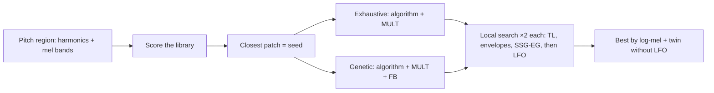

# ADR 0069: FM patch fitting: both structure searches, local search on the grid, an LFO twin per fit (T8.2)

- **Status:** Accepted
- **Date:** 2026-10-31

## Context

Plan task T8.2 is the FM part of pass 3 of the [multi-pass optimizer](../multi-pass.md#candidates): fit a YM2612 patch
to each pitch region of each sample, so that the allocator (M9) can weigh an FM candidate against PSG and PCM ones.
[ADR 0016](0016-fm-fitting-approach.md) chose the method from the papers ([fm-matching.md](../references/fm-matching.md)):
a structure search over the algorithm and multiples (a GA or a pruned exhaustive search), then a local search over the
levels and envelopes on the integer grid, seeded from the nearest built-in patch, deterministic. Acceptance: *fitted
patches beat library patches on per-instrument error.*

T8.1 ([ADR 0068](0068-sample-analysis.md)) gives each region 1 s of the sample at 44.1 kHz as 64 mel bands and up to 64
harmonics. The library had five placeholder patches, on four of the eight algorithms.

## Decision

- **Build and test only** (David): the conversion and its DMF don't use the fits yet. The optimizer will (M9). The
  harness runs the fitting with `--fm-fit`.
- **Both structure searches run** (David), and the corpus decides which one stays. It kept **both**: they tie, and
  the better of the two is about 1 dB closer than either alone (see *On the corpus*).
  - **Pruned exhaustive** (`FmExhaustiveSearch`): every algorithm. Carrier multiples are 1 and the region's four
    strongest harmonics up to 15 (1–4 without a pitch); modulator multiples are 1, 2, 3, 4, 5 and 7. Pruned to
    multiples with no common factor (a common factor only moves the pitch), and operators the algorithm treats alike
    (the carriers of algorithms 5–7, the modulators of algorithm 6) in one order only. Tried in order of how likely
    they are: carriers on strong harmonics first.
  - **Genetic** (`FmGeneticSearch`, after Horner 1993): 32 structures (algorithm, feedback, four multiples, a modulator
    level), 2 elites, tournaments of 3, a gene mutated with chance 1/6. It starts from the seed's structure, one
    structure per algorithm with all multiples 1, and random ones, and stops after 12 generations without a better one
    (150 at most).
  - Each search hands its **2 best structures** to the local search.
- **Local search on the integer grid** (`FmLocalSearch`): coordinate descent, taking the first step that helps and
  repeating it while it does. Steps: TL ±1/±4, MULT, DT, SL and RS ±1, AR, DR and D2R ±1/±4 per operator; TL of every
  pair of operators together (±1, ±3; one alone often only trades one error for another); FB ±1; SSG-EG shapes 8–15
  and off. Modulator TL stays at 8 or more, so a modulator can't swamp the note.
  RR isn't fitted: the note is held for the whole second, so the release is never heard. M9 fits it from the song's
  note lengths if it matters.
- **The scores** (David: both):
  - The search uses the **harmonics** (log-mel without a pitch): the RMS dB difference per frame, after moving the
    patch to the target's total level (TL can match the level; the shape is what's fitted). Both are floored 60 dB
    under the target's peak, so inaudible detail doesn't count. Candidates are first judged on 0.25 s and only the
    promising ones on the full second.
  - The **log-mel distance** (with the MFCC distance beside it) picks the best of the library, the exhaustive fit and
    the genetic fit, and is the acceptance number.
- **The library grows a little** (David): eleven original patches, at least one per algorithm (Bass 0, Strings 1,
  Piano 2, Clav 3, Bell 4, Synth 6 are new). No imported banks. Every region also scores every library patch, and the
  closest one seeds the searches.
- **Every non-silent sample, every pitch region** (David).
- **SSG-EG and the LFO may be used** (David):
  - The patch gains SSG-EG per operator and the LFO depths FMS and AMS (`FmOperator.SsgEg`, `FmPatch.Fms`/`Ams`); the
    DMF writes them. The song player loads SSG-EG, and the depths without the LFO itself (`$22` stays off until M9).
  - The LFO is one setting for the whole chip, so each fit records the **rate it needs** and keeps a **twin fitted
    without the LFO** (`FmRegionFit.NoLfo`). M9 picks one rate per song and uses the twins where a fit needs another.
  - The depths do nothing alone, so the local search also tries the LFO on as one step: each rate with FMS 1, 4 or 7,
    or AMS 1 or 3 with AM on the carriers.
- **The budget counts renders, not time** (David: "as long as it takes" by default). `FmFitOptions.MaxRenders`
  limits each step (each structure search, each local search), so a limited fit gives the same result on any machine.
  The tests use small limits. Searches are seeded (`FmFitOptions.Seed`); the fit is the same on every run.
- **One held note, rendered fast** (`FmNoteRenderer`): the patch is loaded on channel 1 of the `Ym3438` model at the
  region's note pitch, keyed on and played for 1 s at the chip's rate (53,267 Hz NTSC), then resampled to 44.1 kHz with
  a 64-tap windowed sinc (19.5 kHz cut-off). NWaves' resampler took 178 ms per second of audio, which is more than the
  chip; this one takes about 5 ms. A carrier at TL 0 plays at ±1, the level of a full-scale sample. `Render/FmVoice`
  loads a patch, shared with `GenesisPlanPlayer`, so the fit and the song load patches the same way.
- **Shown three ways** (David):
  - **The harness** writes `fm-fit.csv`, one line per region ([harness.md](../harness.md#output)). Its `seconds` column
    is the one thing in the harness reports that changes between runs. That breaks T6.3's *stable scores on reruns*
    for that column only; it was asked for, to judge the cost.
  - **Debug log lines** (`FmFitReport`), one per region, and a corpus line: *fitted FM patches beat the library in X
    of Y pitch regions*.
  - **This ADR** gives the corpus numbers.

### On the corpus

The harness with `--fm-fit` and no limit, 2026-11-01: 240 samples in 19 songs, 327 pitch regions. Log-mel distance in
dB, lower is closer:

| | Median | Mean |
|---|---|---|
| Closest library patch | 12.73 | 12.75 |
| Exhaustive search, fitted | 7.47 | 7.83 |
| Genetic search, fitted | 7.87 | 8.24 |
| **Best** (of the three) | **6.68** | **6.80** |
| Best without the LFO (the twin) | 6.96 | |

- **Acceptance holds:** a fitted patch beats the library in **314 of 327 regions** (the harness' *beat the library*
  line), and on **234 of 240 samples** by the sample's mean. The median gain is 5.5 dB.
- **The two searches tie, so both stay.** Per region the exhaustive search wins 161, the GA 162, 4 ties; by more than
  1 dB, 118 and 97. Neither alone comes close to both: the exhaustive fit alone averages 7.83 dB, the GA alone 8.24,
  the better of the two 6.84. They fail differently. The exhaustive search can't change feedback or the modulator
  level. The GA misses ratios it never samples: on the plain basses of `8bit_castle` it lands 4–7 dB above the
  exhaustive fit, and on some drums and voices it is 5–10 dB better.
- **The library is still best in 13 regions.** Its patch is already close in all of them (5.5–8.8 dB). The searches
  rebuild the envelopes from the seed and lose its detune and fine levels (see *Open questions*). One of the 13
  (`jam_-_latenightcoffee` 15) is at the 60 dB floor everywhere, because its region is almost silent.
- **All eight algorithms are used** by the best fits: 0: 48, 1: 14, 2: 45, 3: 30, 4: 24, 5: 55, 6: 47, 7: 64.
  SSG-EG is in 160 of them.
- **The LFO helps a little.** 198 best fits use it, at every rate (0: 48, 1: 33, 2: 19, 3: 10, 4: 3, 5: 11, 6: 38,
  7: 36), so M9 will need the twins: a song can't run every rate at once. It gains a median 0.12 dB over the twin.
- **Cost:** a median 9,837 renders (at most 12,659) and 413 s per region (at most 1,066 s), 40.5 CPU-hours in all.
  That is 2 h wall time with 8 processors. The optimizer can't afford that per conversion, so a render limit or
  T8.6's cache comes first in M9. A sawtooth probe found the same fit with 300 renders per step as with no limit.

## Options considered

- **Both searches, the corpus picks (chosen); it picked both.** ADR 0016 left the choice open. The exhaustive search
  covers every likely ratio, and the GA also changes feedback and the modulator level.
- **Only the winner of the corpus run.** Each would win about half the regions and lose about 1 dB on average.
- **Only one search, chosen from the papers.** Horner used a GA, but the YM2612 grid is small enough that a pruned
  exhaustive search is possible, so the papers don't settle it.
- **Gradient fitting (DDX7, Sound2Synth).** It needs a differentiable chip model and a training set; the integer grid
  and the exact chip model suit a direct search better.
- **Fitting RR.** With the key held through the analysis there is nothing to fit it to.
- **A time budget.** Simple, but the result would depend on the machine's speed and load.
- **No LFO.** Simpler for M9, but vibrato and tremolo samples fit worse; the twin keeps the no-LFO choice open.
- **Imported patch banks.** Licences and a large search; the fit starts close enough from eleven of our own.

## Consequences

- New layer `src/Optimizer` ([architecture.md](../architecture.md)): `FmFitter`, `FmFitOptions`, `FmNoteRenderer`,
  `FmEvaluator`, `FmStructure`, `FmExhaustiveSearch`, `FmGeneticSearch`, `FmLocalSearch` and `FmFitReport`.
  `Render/FmVoice` holds the patch-loading code that `GenesisPlanPlayer` had.
- `FmPatch` and `FmOperator` gain the LFO depths and SSG-EG; the DMF writes them (`DmfSongBuilder`). The simple
  mapper's patches have none, so its output is unchanged.
- `SampleAnalyzer.Spectrum` is shared with the fitter, so a fitted note and its target are measured the same way.
- M9 uses the fits as FM candidates, picks the song's LFO rate, and loads `$22`.
- Unlimited, a region takes minutes; the optimizer will want T8.6's cache, or a render limit.

## Open questions

- **The `seconds` column** against T6.3: keep it, or move it to `durations.csv`?
- **Refining the library patch itself.** In 13 regions the seed beats both fits, because the structure searches
  rebuild its envelopes. Starting a local search from the seed as well would cost one more refinement per region.
- **Fitting at more than one pitch per region.** One note per region fits that note best; the edges of an octave may
  sound different.
