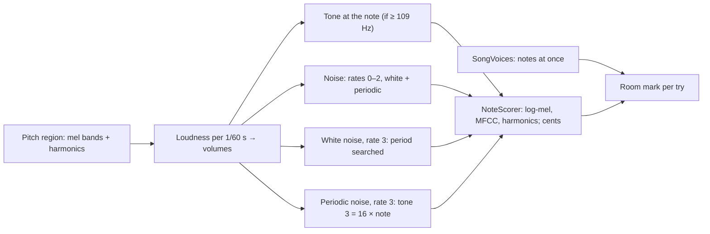

# ADR 0070: PSG candidates: a tone, eight noise tries and a buzz for low notes, scored like FM, marked for room (T8.3)

- **Status:** Accepted
- **Date:** 2026-11-01

## Context

Plan task T8.3 is the PSG part of pass 3 of the [multi-pass optimizer](../multi-pass.md#candidates): for each pitch
region of each sample, how close the SN76489 can get, so that the allocator (M9) can weigh a PSG candidate against the
FM fits ([ADR 0069](0069-fm-patch-fitting.md)) and PCM. The PSG has three square-wave tone channels (10-bit periods, so
nothing below about 109 Hz on NTSC) and one noise channel: white or periodic noise, shifted at clock / 512, / 1024,
/ 2048 or at tone channel 3's rate. Each channel has 16 volume levels ([ADR 0067](0067-psg-volume-levels.md)). The
acceptance is *tests*.

## Decision

- **Build and test only** (David), as for the FM fits: the conversion and its DMF don't use the candidates yet; M9
  will. The harness makes them with `--psg-fit` and writes `psg-fit.csv`.
- **Every non-silent sample, every pitch region, every try** (David): a drum gets a tone try and a flute gets noise
  tries; the scores decide. Each region gets:
  - **A tone** (`PsgSound.Tone`) at the period nearest the region's note (`NoteTarget.NoteHz`), when that period fits in
    10 bits.
  - **Noise at every fixed rate, white and periodic** (David: all four rates): six tries.
  - **The hiss tuned by tone channel 3** (white noise at rate 3): the period is searched, every half octave from 1 to
    1023, then a step either way from the closest, halving the step from a quarter to a sixteenth of an octave.
  - **The buzz tuned to the note** (periodic noise at rate 3, David: offer the low-note trick): Sega's 16-bit shift
    register makes periodic noise a thin pulse at a sixteenth of the shift rate, so tone channel 3 is set to 16 times
    the note. This is the only PSG try that can play a note below a tone channel's range. It is made for every region;
    for a note too low for a tone, it takes the tone's place.
- **The loudness steps every 1/60 s** (David): an NTSC frame, as SGDK's drivers write the PSG. For each step, the mean
  power of the region's spectrum frames centred in it (the nearest frame when none is), relative to the loudest step,
  at the nearest PSG level in decibels (`PsgLevels.Nearest`). The loudest step plays at volume 0: the mapper sets the
  overall level ([ADR 0050](0050-voice-levels.md)), and the score matches the level before comparing. Every try in a
  region uses the same steps. They are not searched: the shape comes straight from the sample.
- **The same ruler as FM** (David): `NoteScorer`, moved out of `FmEvaluator` unchanged, gives the log-mel distance (it
  picks the best), the MFCC distance and, with a pitch, the harmonic distance, against the same 1 s of the region. Each
  try also records its **pitch error in cents** (the PSG's periods are whole numbers), none for white noise.
- **One try, rendered fast** (`PsgNoteRenderer`): the `Sn76489` model of an NTSC Genesis, alone (a tone on tone
  channel 1; noise with tone channel 3 counting but silent), at its own rate (223,722 Hz), the DC taken off at 5 Hz as
  `GenesisChips` does, then brought to 44.1 kHz by the FM renderer's resampler (now `AnalysisResampler`) with 272 taps,
  4.2 times the FM renderer's 64 for the same filter at the faster rate. A square at volume 0 plays at ±1.
- **Every try is kept and marked for room** (David: keep all, just mark them; M9 decides). From the song's notes
  (`SongVoices`, counted while each note sounds: from its start until a one-shot runs out or its volume is 0):
  - **Sample too often** (`PsgRoom.SampleTooOften`): the song sounds the sample on more channels at once than the PSG
    has for the try: 3 for a tone, 1 for noise.
  - **Song too full** (`PsgRoom.SongTooFull`): the try borrows tone channel 3 (noise at rate 3), and the song sounds
    10 or more notes at once, so no Genesis channel is left over for the borrowing.
  - Otherwise **fits**. Whether the channels are actually free is the allocator's to find out, and re-balancing them
    when the song sounds wrong is the refine loop's (T9.3, T9.5; David).
- **Shown three ways**, as for FM: `psg-fit.csv`, one line per try ([harness.md](../harness.md#output)); Debug log
  lines (`PsgFitReport`), one per region; and this ADR's corpus numbers.

### On the corpus

The harness with `--psg-fit`, 2026-11-01: 240 samples in 19 songs, 327 pitch regions, 2,882 tries. Log-mel distance in
dB, lower is closer (the FM fits' best on the same regions: median 6.68, [ADR 0069](0069-fm-patch-fitting.md#on-the-corpus)):

| Closest of each kind | Regions | Median | Mean |
|---|---|---|---|
| Tone | 266 | 19.58 | 19.62 |
| White noise, fixed rate | 327 | 19.67 | 19.83 |
| White noise, tuned by tone 3 (the hiss) | 327 | 16.21 | 16.54 |
| Periodic noise, fixed rate | 327 | 19.45 | 19.65 |
| Periodic noise, tuned to the note (the buzz) | 327 | 20.01 | 20.53 |
| **Best** of the region | 327 | **15.77** | **16.03** |

- **The PSG is about 9 dB further than FM** on the median, as expected: it is the fallback when FM channels run out,
  not a rival.
- **The best try:** the tuned hiss in 250 regions, the tone in 41, the buzz in 30, fixed-rate periodic noise in 6.
- **The ruler prefers hiss to a square, even for tonal samples.** Of the 105 regions of samples T8.1 calls tonal
  (`tone` or `plucked tone`) that have both, the tone beats the tuned hiss on log-mel in 34 and on harmonics in only
  13; it is a median 1 dB worse. A square's odd-only harmonics sit far from most samples' spectra, and level-matched
  noise fills every band, so the spectral distances reward it, though it plays no note. The tries are made right
  (the tone is at its pitch, a median 1.8 cents off, at most 11.9), so this is for M9's objective to settle (see *Open
  questions*).
- **61 regions are too low for a tone** (below about 109 Hz, mostly basses at C-2); the buzz is their only pitched try.
- **Room:** 159 samples sound on one channel at a time, 54 on two, 6 on three, 1 on four, 20 never play. 922 tries
  are marked *sample too often* (all noise tries of samples on two channels or more, and the tone of the sample on
  four); none is *song too full*, since every corpus song has 4 channels. 23 regions have no try with room.
- **Cost:** 31–34 renders and about 1 s per region, about 5 CPU-minutes for the corpus.

## Options considered

- **Every try for every sample (chosen).** A region's 9 tries and the hiss search take 31–34 renders, about a second; filtering by the T8.1 scores would save little and could hide a good surprise.
- **Only likely tries** (tones for tonal samples, noise for noisy ones). Cheaper, but it puts a threshold where the
  score can decide.
- **One fixed volume per try.** Simpler, but nothing that fades would be close.
- **A step every song tick** (about 50 Hz for a MOD), as DefleMask's volume macro runs. David chose the 1/60 s frame,
  which XGM and XGM2 use; the DMF can follow it at its own tick rate when M9 writes PSG notes.
- **Searching the volume steps.** 60 steps of 16 levels; the direct fit from the loudness is already the sample's shape,
  and M9's refine loop can come back to it.
- **Dropping the tries the song has no room for.** David chose to keep them, marked: room depends on what the
  allocator puts elsewhere.
- **A PSG-only score.** Quicker to build, but its numbers couldn't be weighed against the FM fits.

## Consequences

- New in `src/Optimizer`: `PsgSetting` (with `PsgSound`, `PsgRoom`), `PsgNoteRenderer`, `PsgFitter` (with
  `PsgCandidate`, `PsgRegionFit`, `PsgSampleFit`) and `PsgFitReport`; `NoteScorer` and `AnalysisResampler`, taken out
  of `FmEvaluator` and `FmNoteRenderer` without changing a number. `FmTarget` and `FmScore` are now `NoteTarget` and
  `NoteScore`, since both kinds of candidate use them.
- New in `src/Analysis`: `SongVoices`, how many notes the song sounds at once; `ConversionCommand`'s analysis hook
  hands it to the harness with the analyses. `SampleBlock.IsSilence` is the end-of-sample test the MOD renderer had.
- The plan's notes have no PSG tone voice yet (`VoiceKind` has only noise); M9 adds it when it places PSG candidates.
- The drop clues per song track (plan T8.7) come next: which tracks are cheap to drop or merge when the room marks
  say the song is full.

## Open questions

- **A pitch term for M9.** Log-mel and harmonic distances let unpitched hiss beat a square on most tonal samples. Before
  the allocator trusts them for PSG against FM, it needs something that rewards playing the note: weight the harmonic
  distance by how periodic the candidate is, or only let pitched tries stand in for tonal samples. Measure it on the
  whole-song render (T9.5), where a hiss in place of a melody is easy to hear.
- **The tuned hiss's search often ends at period 1023** (the slowest shift, about 109 Hz). A slower clock isn't possible
  on the PSG; whether such a low rumble is what M9 should choose for drums is for the listening tests.
