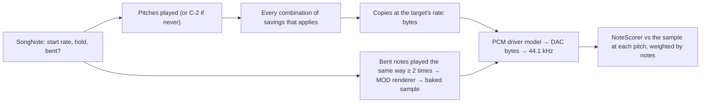

# ADR 0071: PCM candidates: a copy per pitch played, every combination of four savings, baked notes for repeated effects (T8.4)

- **Status:** Accepted
- **Date:** 2026-11-01

## Context

Plan task T8.4 is the PCM part of pass 3 of the [multi-pass optimizer](../multi-pass.md#candidates). The Genesis plays PCM
at a fixed rate with no volume and no pitch change ([sample-capacity.md](../sample-capacity.md#why-capacity-runs-out-even-though-a-mod-has--31-samples)),
so every pitch a sample is played at needs its own pre-resampled **copy**. Copies cost bytes, and each target has hard caps:
DMF 144 DAC notes and 1 voice, XGM 63 samples and 4 voices, XGM2 122 samples and 3 voices. The allocator (M9) needs, per
sample, what each way of storing it costs and how close it sounds, on the same ruler as the FM fits
([ADR 0069](0069-fm-patch-fitting.md)) and the PSG tries ([ADR 0070](0070-psg-candidates.md)). The acceptance is *tests*.

## Decision

- **Build and test only** (David), as for FM and PSG: the conversion and its DMF don't use the candidates yet; M9 will. The
  harness makes them with `--pcm-fit` and writes `pcm-fit.csv`.
- **Every target, always** (David): DMF, XGM and XGM2 each get their own candidates (`PcmTarget`, `PcmTargets`).
- **The cost is bytes** (David): DMF stores 16-bit points (2 bytes each); XGM and XGM2 store 8-bit points in 256-byte
  blocks. **Slots and voices are hard caps** (David), not costs: each option says whether the sample alone already breaks
  them (`PcmRoom`: *sample too often* when the song plays it on more channels at once than the target has voices; *too many
  copies* when it needs more copies than the target has slots). Whether the whole song fits is M9's question.
- **A copy per pitch the song starts the sample at** (David: every pitch played): `SongNote` (new, `src/Analysis`) finds
  every note, the rate and volume it starts at, how long it sounds (until the next note on its channel, its sample runs
  out, the channel swaps samples, or the song ends) and whether it **bends**: starts past frame 0, or changes pitch or
  volume while it sounds. A copy holds the pitch the note starts at.
  - DMF: stored at the lowest rate code at or above the note's rate (as the DMF writer does); XGM at the driver's ~14 kHz;
    XGM2 at 13.3 kHz.
  - A looped sample is played out as long as the song holds any of its notes, from 0.5 s to 10 s (as the DMF writer's
    copies); a one-shot whole.
  - **A sample the song never plays gets one copy anyway** (David), at C-2, for M9's mid-song swaps.
- **Four savings, every combination that applies** (David: "try different combinations to see which has the least impact"),
  each a `PcmSavings` flag:
  - **Half speed** (XGM2 only): 6.65 kHz, half the bytes.
  - **Semitones:** pitches whose **measured** pitch (the playback rate over the sample's cycle, `SamplePitch`; David: a
    sample isn't always recorded in tune with its notes) rounds to the same semitone share the most played one's copy, a
    few cents off for the rest. Without a measured cycle, the rate itself is rounded.
  - **Short loops:** a looped copy is played out only as long as the song holds that pitch.
  - **Trim tail:** a one-shot is cut after its last point within 48 dB of its peak (about one 8-bit step), with a 5 ms
    fade so the cut doesn't click.

  A saving applies only when it changes something for the sample; the options are the plain copies first, then each
  combination, fewest savings first.
- **Scored at every pitch played, on the FM fits' ruler** (David): each copy is played through the target's PCM driver
  model alone (`PcmNoteRenderer`: `DmfDac`, `XgmPcmDriver`, `Xgm2PcmDriver`, unbuffered, on an NTSC Genesis), the DAC byte
  taken as the sound and brought to 44.1 kHz, and scored with `NoteScorer` against the sample played at that pitch by the
  converter's resampler. The target is silent after the longest the song holds the pitch, as the notes are, and both are
  scored over that hold, from 0.1 s to 1 s. Each option's distance is its pitches' distances weighted by their notes.
- **Baked notes, for repeats only** (David): a bent note is rendered by the MOD renderer (alone, centred) with its effects,
  start point and volume, up to 10 s, and resampled to the target's rate. Notes that play the same way (same start frame
  and the same rate, volume and length on every tick, so the same bytes) share one baked sample, offered only when at least
  two notes share it. Each is scored against the rendered note, next to the plain copy at its starting pitch (from frame 0,
  at full volume) that would play it otherwise.
- **Shown three ways**, as for FM and PSG: `pcm-fit.csv` ([harness.md](../harness.md#output)), one line per option and per
  baked sample; Debug log lines (`PcmFitReport`), one per sample and target; and these corpus numbers.

### On the corpus

The harness with `--pcm-fit`, 2026-11-01: 19 songs, 240 samples (20 never played), 42,984 notes, a median of 3 pitches per
sample; about 3 minutes for the corpus and all three targets. Log-mel distance in dB, note-weighted, lower is closer (the
FM fits' best: median 6.68; the PSG's best: median 15.77):

| Target | Plain copies | Bytes, all 19 songs | Median song |
|---|---|---|---|
| DMF | 8.93 dB | 63.3 MB | 1,543 KB |
| XGM | 9.09 dB | 28.4 MB | 665 KB |
| XGM2 | 7.98 dB | 26.9 MB | 629 KB |

Each saving on every sample it applies to, against the plain copies (XGM2; DMF and XGM are alike without half speed):

| Savings | Bytes | Distance |
|---|---|---|
| Short loops | 43.2 % | −0.04 dB |
| Semitones | 99.5 % | +0.00 dB |
| Trim tail | 100.0 % | −0.01 dB |
| Half speed | 50.3 % | +2.95 dB (mean per sample +3.06, worst +9.99) |
| Semitones + short loops + trim tail | 42.7 % | −0.04 dB |
| All four | 21.6 % | +2.91 dB |

- **Short loops are free and save the most:** 62 looped samples are played out far longer than any of their notes is
  held. M9 should always use them; they are only a choice here because David asked for every combination to be measured.
- **Semitones and trim tail barely matter on this corpus:** notes start on ProTracker's period table, so only one sample has
  two pitches within a semitone; and MOD one-shots rarely carry a long quiet tail (64 apply, saving a few hundred bytes).
- **Half speed is the only lossy saving:** it halves the bytes for about 3 dB, much more on bright samples.
- **The copies sound about as far as the FM fits on this ruler**, though they are the sample itself: the DAC holds each
  byte, and those steps put images and 8-bit noise into the 7–22 kHz mel bands that the original lacks. The whole-song
  Genesis render has no output filter either, so the end-to-end score (T9.5) sees the same (see *Open questions*).
- **Almost nothing fits 128 KB yet:** with the smallest option per sample, 5 of 19 songs fit as XGM2 and 1 as XGM. The
  caps bite too: plain copies need 11 to 136 slots per song, more than XGM's 63 in 6 songs and XGM2's 122 in 1 (none
  past DMF's 144), and 61 samples play on two channels at once, too often for DMF's one DAC. The budget is M9's to meet by
  moving sounds to FM and PSG.
- **Bent notes:** 9,350 notes bend; 8,746 of them repeat and are baked into 889 samples (12.2 MB as DMF, 5.3 MB as XGM,
  5.1 MB as XGM2). A baked sample is closer than the plain copy in 777 of 889 (XGM2; median 6.63 dB against 9.63). 889 is
  far more than any target's slots, so M9 can afford only the most played.

## Options considered

- **Every combination of the savings (chosen).** At most 16 per sample, cheap once copies and targets are cached.
- **Each saving alone, plus all of them.** Fewer options, but it can't show that one saving makes another free or useless.
- **Score one copy per pitch region**, as FM and PSG do. Faster, but a region is up to an octave wide and every pitch played
  is a copy of its own; David chose every pitch.
- **Volume and start-point copies** (the DMF writer's per 3 dB and per `9xx`). Not chosen: they multiply the bytes, and
  baked notes cover the start points and volume changes that repeat.
- **Baking every bent note.** A note played once would get its own sample; David chose repeats only.
- **Bytes as the only number.** David asked for the slot and voice caps to be kept as hard limits, so each option is marked.

## Consequences

- New in `src/Optimizer`: `PcmTarget` (with `PcmSavings`, `PcmTargets`), `PcmNoteRenderer`, `PcmFitter` (with `PcmCopy`,
  `PcmPitch`, `PcmOption`, `PcmRoom`, `PcmBaked`, `PcmSampleFit`) and `PcmFitReport`.
- New in `src/Analysis`: `SongNote`, every note with its hold and whether it bends; and `SongAnalysis`, which the
  conversion's analysis hook now hands over (song, playback, sample analyses, voices, notes) in place of two arguments.
- The harness gets `--pcm-fit` and `pcm-fit.csv`.
- The drop clues per song track (plan T8.7) and the target limits model (T9.1) can read the room marks and bytes from here.

## Open questions

- **An output filter for the ruler.** The Model 1 Genesis has an analog low-pass on its output that softens the DAC's steps.
  Neither the PCM scores nor the whole-song render model it, so both may make PCM sound further than it is. Measure it on
  real hardware recordings or in the listening tests before M9 weighs PCM against FM.
- **Looping by re-playing the loop.** Most bytes are loops played out for seconds. A copy of the attack plus one of the
  loop, re-played by the music every loop length, would save most of them, at the cost of a seam on every repeat and a
  command per repeat. Worth measuring with the PCM driver models (T7.4) when M9 or the XGM writers (M10, M11) need it.
- **Shorter one-shots.** A one-shot cut by the next note on its channel could, like a short loop, be stored only as long
  as the song lets it sound. Not one of the four savings David chose; easy to add.
- **Baked notes at half speed.** Baked samples are made at full speed only; on XGM2 M9 may want them at half speed too.
