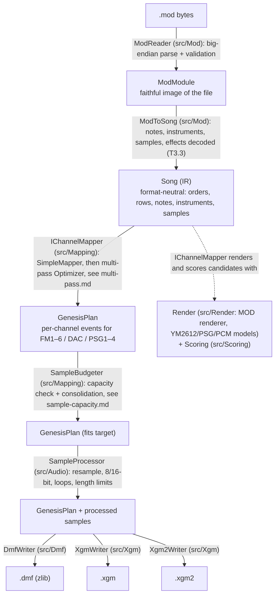

# Architecture

## Pipeline

Each arrow is a pure function of its input plus a shared `ConversionNotes` collector (each note is logged
via Serilog at `Warning` level — see AGENTS.md § Logging). No layer
reads files except `ModReader`'s caller, and no layer writes files except the CLI.

## Layers

**ModReader** — Detects variant (31 vs 15 samples, channel tag), parses header, sample headers,
order list, patterns and sample data. Rejects malformed or unsupported files with
`ModFormatException(offset, reason)`. Does no interpretation.

**ModToSong** (`src/Mod`, plan T3.3) — Builds the `Song` from a `ModModule`: periods become pitches
(`AmigaPitch`, with the `--input-region` clock), sample slots become instruments and samples, and each cell's effect
command is decoded by `ModEffects`, all under the rules of the player the file was read with (`ModModule.Player`:
`--player`, or ProTracker 2 / Ultimate Soundtracker by format; formats/mod.md#players). It lives in `src/Mod`
because the model may not reference MOD types. Following the song through time — `Fxx` speed/BPM changes, pattern
break / position jump (`Dxx`/`Bxx`), effect memory and the loop point — is the **tick player** (T3.4).

**ModTickPlayer** (`src/Mod`, plan T3.4) — Plays the MOD tick by tick: a C# port of ProTracker 2.3's replayer as
pt2-clone reproduces it, reading the raw cells so every quirk carries over (David). Its output is the format-neutral
**`Playback`** (`src/Model/Playback.cs`): one pass through the song, every tick with its time, position and LED-filter
state, and every channel's pitch, volume, pan and the sample parts Paula plays (the part that starts, the part that
repeats); plus the loop point. The MOD renderer (T7.1) and the XGM writers read it; the DMF writer reads the `Song`.
One departure from ProTracker: a song with notes beyond its three octaves plays them as OpenMPT does
([ADR 0055](adr/0055-notes-beyond-protracker-range.md)).

**ModRenderer** (`src/Render`, plan T7.1, [ADR 0054](adr/0054-mod-renderer.md)) — pure C#: mixes a `Playback` to
stereo (`StereoAudio`) the way libopenmpt does by default: an 8-tap Kaiser sinc (`SincTable`, with OpenMPT's two
downsampling tables), 75/25 panning, volume ramps, a crossfade on each new note and click removal at sample ends. Tick
lengths can be given (`ModRenderOptions.TickDurations`) to render in OpenMPT's time. It is the optimizer's in-app
reference; the harness checks it against libopenmpt ([harness.md](harness.md#in-app-mod-renderer)).

**Ym3438** (`src/Render/Fm`, plan T7.2, [ADR 0056](adr/0056-ym3438-model.md)) — pure C#: the FM chip as a C# port
of ymfm's YM3438 (the clean chip, no ladder effect), bit-exact with ymfm. Register writes in, one stereo sample per
144 master clocks out; the Genesis renderer (T7.5) owns the clock and the mixing. Checked against ymfm and
Nuked-OPN2 on register-write probes (`tests/golden/ym3438/`).

**Sn76489** (`src/Render/Psg`, plan T7.3, [ADR 0057](adr/0057-sn76489-model.md)) — pure C#: the PSG as a C# port of
MAME's Sega PSG (`segapsg`), bit-exact with MAME. Port writes in, one mono sample per 16 PSG clocks out (223.7 kHz on
NTSC); the Genesis renderer (T7.5) owns the clock, resampling and the mix with the FM chip. Checked against MAME and
Nuked-PSG on write probes (`tests/golden/sn76489/`).

**PCM driver models** (`src/Render/Pcm`, plan T7.4, [ADR 0058](adr/0058-pcm-driver-models.md)) — pure C#: what SGDK's
XGM and XGM2 Z80 drivers and DefleMask's FM6 DAC put on the YM3438's DAC. Plays and stops in, the `$2A` and `$2B`
bytes for every YM3438 sample out (`IDacSource`): ordered mixing stuck at ±127, 256-byte padding, priorities and
each driver's DAC on/off rule. The Genesis renderer (T7.5) writes them into `Ym3438`. Checked by tests built from the
drivers' source; T7.9 checks them against the real drivers.

**Song (IR)** (`src/Model`, plan T3.1) — Holds what any output needs, in format-neutral units, with 0-based numbering:

- `Title`; `Channels` → starting pan, −1 left … +1 right (Amiga MODs: −1, +1, +1, −1)
- `Orders` (pattern indices) and `LoopOrder` (where the song continues after its end, or none)
- `Patterns` → `Rows` → one `Cell { Note?, Instrument?, Volume?, Effects }` per channel
- `Note` = `NotePitch(Semitone, Cents, PlaybackRateHz)`: the musical pitch (semitone from C-0 plus unrounded cents)
  **and** the exact rate the sample is played at, both computed from the same source value (MOD: period + Amiga
  clock, T3.2), so writers can place notes and renderers can match the source exactly
- `Volume` 0–1 (MOD `Cxx`: xx / 64); `Effects` → one named record per kind (`Arpeggio`, `PitchSlide`,
  `TonePortamento`, `Vibrato`, `VolumeSlide`, `PositionJump`, `PatternBreak`, `SetSpeed`, `SetTempo`, … every
  ProTracker effect, plus `UnsupportedEffect` for commands with no agreed meaning). Pitch slides and vibrato name
  their scale (`AmigaPeriod` or `Cents`), because Amiga-style players slide the period, not the pitch. A `null`
  parameter means effect memory, resolved by the tick player (T3.4). One source command may become several
  effects (MOD `5xy` = tone portamento + volume slide).
- `Instruments` → `Sample` index + default volume (0–1) + finetune in cents
- `Samples` → name, mono `float[]` −1…+1 (8-bit input converts exactly), forward loop (start, length in frames)
- `Timing` → initial speed and BPM (tick rate = BPM × 2 / 5 Hz). The Genesis region is an output option, not part of
  the song.

The constructors of `Song` and `Sample` check that every reference points inside the song (orders → patterns,
loop order, one cell per channel, instruments → samples, loops inside sample data). Nothing in `src/Model` may use
`Mod2Xgm.Mod`; `tests/Mod2Xgm.Tests/Model/ModelBoundaryTests.cs` enforces it.

**IChannelMapper** — Decides which Genesis channel plays each MOD channel/instrument, and how (DAC sample,
FM patch, PSG). Several implementations can exist; selected by CLI flag. See
[channel-mapping.md](channel-mapping.md).

**SimpleMapper / GenesisPlan** (`src/Mapping`, plan T5.3, [ADR 0040](adr/0040-simple-mapper.md)) — the first
`IChannelMapper`. Its output, `GenesisPlan`, has one pattern **per order** (what a note sounds like depends on the
instrument and volume the channel carried in), ten columns per row (FM1–5, FM6/DAC, PSG1–4), the FM patches and DAC
samples the notes use, and per-row song-wide effects (`Flow`). `SampleTraits` (brightness, noise) and `FmPatchLibrary`
(five placeholder patches) are its stand-ins until scoring (M6) and fitting (M8).

**Scoring** (`src/Scoring`, plan T6.2, [ADR 0042](adr/0042-scoring-metrics.md)) — pure C#: says how close a rendering sounds to the
original. `AudioSignal` (mono audio) → `Alignment` (constant lag from the note-start curves) → `SpectralMetrics`
(multi-resolution log-mel distance, MFCC distance on `MelAnalyzer`/`FftPlan`) and `OnsetMetrics` (note-start precision,
recall, timing) → `SongScorer.Compare` → `ScoreReport` with a combined number to minimize. `BalanceMetrics` compares
each instrument's loudness over time from stems (each instrument alone), after the overall gain
([ADR 0051](adr/0051-instrument-balance-metric.md)). Used by the accuracy harness
(T6.3) and the optimizer's candidate tournament (M9); it logs each step at Debug.

**ModReport** (`src/Mod`) — called **unconditionally** by the conversion command: prints the metadata and
full sample table from `ModModule` right after reading (before any later stage can fail), and the output instrument table after budgeting. See
[cli.md](cli.md#console-report).

**SampleBudgeter** — computes required sample slots, simultaneous PCM voices and PCM bytes for the target,
logs the capacity warning, and runs the consolidation steps (dedupe, trim, pitch quantize, merge, mid-song
substitution, voice stealing). Applies `--ignore-samples` before anything else.

**SampleProcessor** (`src/Audio`, plan T5.1) — Converts sample data to what the target accepts: resamples (`smooth`
windowed sinc via NWaves, or `amiga` Paula steps; `--resampler`), unrolls a loop to a length, cuts data past a loop
end, trims trailing silence, applies MOD volume where the target cannot, and converts to 16-bit or 8-bit signed PCM,
clipping with a conversion note. A toolbox: the mapper picks rates, lengths and volumes
([ADR 0038](adr/0038-sample-processor.md)).

**DmfTimingPlanner / DmfSongBuilder** (`src/Dmf`, plan T5.4–T5.5, [ADR 0043](adr/0043-dmf-timing.md),
[ADR 0044](adr/0044-dmf-effects-and-song-grid.md)) — turn a `GenesisPlan` into a `DmfFile`: the clock, then the grid
(one DMF pattern per order) with notes at each sample's measured pitch (`SamplePitch`), volumes in decibel steps,
Amiga stereo, DAC sample copies per loudness and start point, noise instruments that fade like their sample, and
every effect in DefleMask's units (`DmfPatternTranslator`, `DmfUnits`).

**Writers** — Serialize the plan. The DMF writer emits pattern data that DefleMask plays; XGM writers emit
a per-frame register-write stream (they need a small "player" that runs the song tick by tick to produce
YM2612/PSG writes — shared between XGM and XGM2).

## Why an IR

MOD is only the first input, and DMF / XGM / XGM2 are very different (pattern-based vs register stream).
The IR keeps the MOD quirks in one place and lets the mapping experiment without touching parsers or writers.

## AOT considerations

Everything is plain classes/records and spans; no reflection. Native libraries (e.g. a MOD renderer or a
YM2612 emulator core used for in-app scoring) are called via P/Invoke with source-generated
`[LibraryImport]` and preferably statically linked into the AOT binary. No external processes are started. Compression uses `ZLibStream`. Keep the
binary small: avoid LINQ-heavy hot paths only if profiling says so — correctness and clarity first.
