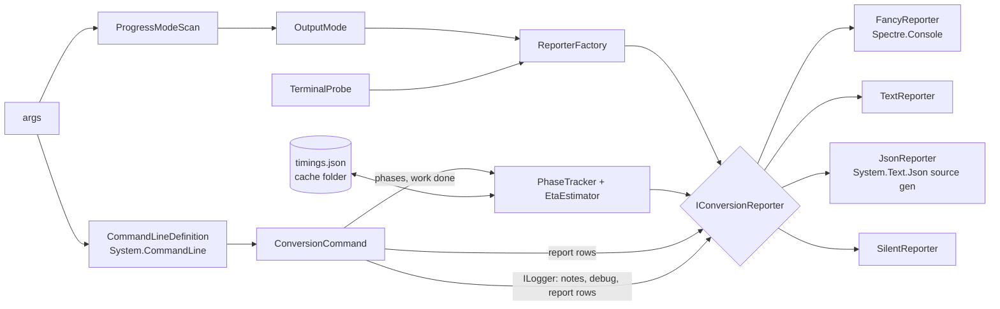

# Console output for people and agents

> Status: **built** (T17.1–T17.8) — the design for plan milestone **M17** ([implementation-plan.md](implementation-plan.md#m17--console-output-for-people-and-agents)),
> decided in [ADR 0077](adr/0077-console-output-modes.md). The report's content and line format are in
> [cli.md](cli.md#console-report).

## Goals

1. Say at every moment **which step** of the conversion is running, **how many steps are left**, how far the
   current step is, and **about how long** until the end.
2. Look good to a person at a terminal (Spectre.Console progress bars and tables).
3. Be easy for an AI agent or another program to drive: a stable text format, a JSON format, and a silent mode,
   with **no prompt, menu or wait for input, ever**.
4. Keep the hard constraints: Native AOT with zero warnings on win-x64, linux-x64 and osx-arm64, no reflection, no
   network, `InvariantGlobalization`.

## One switch: `--progress <mode>`

| Mode | For | What it prints |
|---|---|---|
| `fancy` (default) | a person | Spectre.Console: a header, the report as tables, a live progress area (step bar + total bar), conversion notes in color, a timing table, the result. |
| `text` | AI agents | The compact line format below: no color, no animation, one fact per line, stable keywords. |
| `json` | other programs | One JSON object per line (NDJSON) on stdout, schema below. Every message, not just progress. |
| `silent` | scripts that only need the exit code | **Nothing at all**, not even errors or a crash; only the exit code says what happened. `--help` and `--version` still print, because they were asked for. |

There is **no auto mode** (David): the converter never switches mode by itself. `fancy` stays `fancy` when the output
is piped or redirected; Spectre.Console then turns off animation and color codes on its own: tables print as static text and the live
progress area prints nothing, so `fancy` prints one static line per finished step instead (T17.1 spike). An agent passes `--progress text` (or `json`) in its tool declaration.

`--progress silent` is the one exception to "the MOD metadata and the sample table are always printed"
([ADR 0008](adr/0008-report-on-every-conversion.md), superseded in part by ADR 0077). Every other mode prints them.

`--verbose` works in every mode except `silent`: `Debug` detail is dimmed in `fancy`, a `debug` line in `text`, a
`"type":"debug"` object in `json`.

### Streams

| Mode | stdout | stderr |
|---|---|---|
| `fancy` | everything, including conversion notes (one console, so the live area never tears) | the error message, after the live area has closed |
| `text` | every line except `error` | `error` lines |
| `json` | every object, errors included: an agent reads one stream | nothing |
| `silent` | nothing | nothing |

David had no preference; this split is the proposal in ADR 0077.

A redirected stdout or stderr is written in **UTF-8** (no byte-order mark) in every mode, whatever the console's code
page: on Windows that is the OEM code page, which can't hold names like `é` or `fancy`'s drawing characters. A
console that isn't redirected keeps its own encoding, and its code page is never changed.

## Never interactive

- The converter never reads stdin and never calls `AnsiConsole.Prompt`, `Confirm`, `SelectionPrompt` or anything
  else that waits for a key, in any mode. A test runs every mode with stdin closed and a timeout.
- A missing or bad argument (no input file, unknown option, bad value) exits **1** at once with a message that
  names the argument and shows the usage line. In `json` it is one object:
  `{"v":1,"type":"error","code":1,"error":"usage","message":"Required argument missing: <input.mod>","missing":["input"],"usage":"mod2xgm <input.mod> [options]"}`.
- `--progress` is read **before** the rest of the command line (a pre-scan of `args`), so even a parse error comes
  out in the chosen mode, and `silent` stays silent.
- Parsing stays on **System.CommandLine**: it is AOT-safe and already approved. **Spectre.Console.Cli**
  (`CommandApp`) is not used: it binds settings by reflection and is marked not AOT-compatible, which breaks the
  zero-warning AOT rule ([ADR 0077](adr/0077-console-output-modes.md#options-considered)).

## The orchestration layer (`src/Output/`)



- **`OutputMode`** — `Fancy`, `Text`, `Json`, `Silent`; on `ConversionOptions` as `Progress`.
- **`TerminalProbe`** — reads once: `Console.IsOutputRedirected`, `Console.IsErrorRedirected`, the console width,
  `NO_COLOR`, `TERM=dumb`, and Spectre's detected `Capabilities` (Ansi, Interactive, ColorSystem). It never changes the
  mode; it only configures the `fancy` console, and its findings are logged at `Debug`.
- **`IConversionReporter`** — everything the user sees goes through it: `RunStarted`, `Phase` (start, progress, end),
  `Completed` and `Failed` take typed records (`RunInfo`, `PhaseUpdate`, `RunOutcome`, `RunFailure`), never
  preformatted text. Everything else arrives as Serilog events.
- **Report rows** — the report's lines (metadata, the sample table, the output table, the result) are still logged as
  text, so the log lines and their golden files don't change, and each carries a **`ReportRow`**: a structured
  `"Report"` property attached with `logger.ForContext(row)` (kinds `metadata`, `sample`, `output`, `instrument`, `analysis` (at `Debug`),
  `result`; `part` marks the table's other lines). `text` and `json` write the row's fields and skip the line text;
  `fancy` draws them as table cells.
- **The reporter is the Serilog sink** — every reporter is an `ILogEventSink`, so `Warning` events (conversion
  notes), `Debug` events and report rows reach it through the logger. Serilog stays the logging pipeline and the 61
  stages that take a `ConversionNotes` / `ILogger` do not change. The console sink is gone from the converter: nothing
  writes to the console except the reporter.
- **`PhaseTracker`** — knows the phase list for this run (`ConversionCommand.Phases`, from the options), the current
  step, the work done in it, and times every phase with `TimeProvider` (a fake clock in tests). It passes progress to
  the reporter at most every 100 ms.
- **`Program.Run`** — creates the reporter first; `ConversionException` → `Failed` + its exit code (a command line
  that can't be used is a `UsageException`: its problems, the missing arguments and the usage line); any other
  exception → `Failed` (with the stack trace in `fancy`/`text`/`json`, nothing in `silent`) + exit 5.

## Phases

The steps are known before the first one starts, so "step 5 of 9" is true from the start. Which steps a run has
depends on its options:

| # | Phase (`id`) | When | Work counted (`unit`) |
|---|---|---|---|
| 1 | Check paths (`check`) | always | — |
| 2 | Read MOD (`read`) | always | `bytes` (at the end: the read is one call) |
| 3 | Scan sample use (`scan`) | always | `rows` played (at the end) |
| 4 | Build song model (`model`) | always | — |
| 5 | Play ticks (`play`) | always | — |
| 6 | Analyze samples (`analyze`) | `--verbose`, the harness, and (M9) the optimizer | `samples`, one by one |
| 7 | Map channels (`map`) | always | — |
| 8 | Write DMF (`write`) | `--format dmf` (with `--info` it builds the DMF but writes nothing) | — |
| 9 | Render WAV (`render`) | `--render-wav` | `ticks`, one by one |

Steps are numbered within the run, so a plain DMF conversion has 7 (`step 6/7 map`). Only the two slow steps count
their work as they go; the others take well under a second on real songs, and their ids, names and units are a
contract of the `text` and `json` output and of the timing history.

When the optimizer lands (plan M9) it adds its passes as phases (`fit-fm`, `fit-psg`, `fit-pcm`, `pre-mix`,
`allocate`, `refine`), each counting candidates or rounds; `refine` under `--time-budget` counts time against the
budget, so its bar and estimate are exact.

Stages report work through a small optional **`IWorkCounter`** parameter (`SetTotal`, `Advance(n)`;
`SampleAnalyzer.AnalyzeSong`, `GenesisRenderer.Render`), with a no-op default so tests and the harness need not pass
one. `ConversionCommand.Execute` takes an **`IConversionProgress`** (`Begin`, `Start(id)` → a phase with `Done()`,
`SetSongRows`); `Program.Run` passes a `PhaseTracker` and hands its timings to the reporter at the end, success or failure. Counting is cheap (an integer add); the reporter throttles what it shows:
`fancy` redraws at most 10 times a second, `text` writes a progress line at most every 5 s, `json` a progress
object at most once a second, plus every start and end.

## Time estimate

- **Current step:** once a step has done at least 2 % of its work and run for 0.5 s, remaining =
  elapsed × (total − done) / done, smoothed (exponential moving average) so it doesn't jump.
- **Steps not started yet**, and the current step until it has a pace of its own: from **history**: the seconds per
  unit of song size each phase took on earlier runs, times this song's size in that unit. `render` scales with the
  **ticks** played (known after `play`), `analyze` with the **samples** it analyzes (known after `play`), every other
  phase with the **rows** played (known after `scan`). Before its size is known, and with no history, a phase's
  estimate is unknown. `check`, `read` and `scan` run before any size is known, so they never get history; they take
  well under a second.
- **Measured** (2026-11-03, Debug build, history from two runs of `cancan.mod`, `--verbose --render-wav`): at the
  start of `analyze`, `map` and `render`, the estimate of the time left was within 8 % of the real time on
  `10kdub.mod`, `8bit_castle.mod` and `cancan.mod`. Rows alone were 37–50 % short on the other songs: a row's ticks
  depend on the song's speed, and the render's time per tick barely varies (0.0027 s on all three).
- **Total:** current remaining + the sum of the estimates for the steps left. When any part is unknown the total is
  shown as `about 12 s+` in `fancy`, `eta=12s+` in `text`, `"eta_s":12,"eta_partial":true` in `json`; with nothing
  known, `—` / `eta=?` / `"eta_s":null`.
- **History file:** `timings.json` at the **root** of the candidate cache folder (`--cache-dir`, default
  [cli.md](cli.md)), outside the per-build folders so it survives new builds:
  `{"v":1,"seconds_per_unit":{"map":0.00005,"render":0.0025,…}}`. Each run moves a phase's number halfway towards its new
  pace. Saved when the run ends, success or failure, for the phases that finished: written to a temporary file and
  renamed over the old one. Read with `JsonDocument` and written with `Utf8JsonWriter` (no reflection). A file that
  can't be read or written, has another `v`, or holds a value that isn't a non-negative number is ignored with a
  `Debug` line, never a failure. `--no-cache` neither reads nor writes it, and then only the current step has an
  estimate.

## `fancy`

The default (`FancyReporter`; whole run: `tests/golden/output/fancy-conversion.txt`):

- A header rule: `mod2xgm 0.x · song.mod → DMF · quality normal · 7 steps`.
- Report section 1 as a two-column grid, section 2 as a `Table` (the same columns as the line format, status colored:
  used green, ignored yellow, unused and empty dim), section 3 as a `Table` titled with the output's counts. A table
  is printed when its last row has come (the next line of any other kind).
- **Live area**, on a console that can redraw: two lines, the step (`[5/7] Map channels`, bar, %, time spent, time
  left) and the **total** (bar weighted by the time estimates, time spent, time left), each fitting 80 columns. A
  step whose share is unknown shows `…` and a dim bar. The bars are drawn here (`━`, done part green), not with
  Spectre's `Progress`, which owns its loop: the conversion calls the reporter step by step, so a Spectre
  `LiveDisplay` runs on its own thread and is fed each update (at most every 100 ms, `PhaseTracker`).
- Conversion notes print above the live area in yellow (`note …`), `Debug` lines dimmed, as they happen: Spectre
  prints a write made during a live display above it.
- **Piped or `TERM=dumb`:** no live area and no escape codes (Spectre draws nothing for a live display there, the
  T17.1 spike), so each finished step prints one static line: `✓ [5/7] Map channels 0.1 s`. A redirected output has
  no width, so Spectre's default of 80 columns applies.
- End: a timing table (step, time, work), then `Done → <output>, 10 conversion notes in 1.2 s`; on stderr, after the
  live area has closed, `error <message> (exit 4)`, or for a usage error its problems, the usage line and the help
  hint, and for a crash the stack trace.
- **Escaping:** sample names and the title can hold `[` and `]`, which Spectre markup reads as styles. Names are
  always passed as `Text` objects or through `Markup.Escape`, never interpolated into markup (the same rule as
  Serilog's braces in [cli.md](cli.md#console-report)).

## `text`

One line per fact: a keyword, then `key=value` pairs; values with spaces or quotes are quoted with `\"` escapes;
numbers invariant. Approved shape (David, 2026-11-02):

```
run mod2xgm=0.1.0 input="song.mod" format=dmf quality=normal steps=9
meta file="song.mod" bytes=21802 title="space {debris}" format="ProTracker M.K." channels=4 slots=31 orders=2 restart=127 patterns=2 speed=4 bpm=140
sample 01 "bassdrum" len=4532 loop=- vol=64 fine=0 notes=3 used
sample 03 "  by Jester" len=0 loop=- vol=0 fine=0 notes=0 empty
step 5/9 mapping start | eta 12s
step 5/9 mapping 40% | 3.1s | eta 9s
note: Effect 7xy (tremolo) on channel 2, row 14 dropped
step 5/9 mapping done | 4.0s
output dmf fm=1 psg=1 dac=3 pcm_bytes=13312
output FM 01 <- 01 "lead", 02 "pad" (Sine patch)
time read=0.0s scan=0.1s model=0.0s play=0.4s map=4.0s write=0.1s total=18.2s
result ok exit=0 out=C:\music\song.dmf notes=12 time=18.2s
```

Other lines: `note: <message>` for each conversion note, `info <message>` and `debug <message>` (with `--verbose`) for
everything else, the message on one line with its strings unquoted. Names and titles are always quoted; other text is
quoted only when it holds a space, a quote, `=` or `|` (or is empty), so a bare Windows path keeps its `\`; inside quotes
`"` and `\` are escaped and control characters show as `·`.

Errors go to stderr: `error exit=2 kind=input-not-found message="Input file not found: song.mod"`. `kind` is one of
`usage`, `input-not-found`, `invalid-input`, `output-not-writable`, `does-not-fit`, `internal`. A usage error adds
`missing=<names>` (comma-separated) and `usage="mod2xgm <input.mod> [options]"`; a crash adds one `stack <line>` per
line of the stack trace. The XGM2 line is printed verbatim as
`info NOTE: SGDK expects XGM2 files to use the .XGM file extension.` so the exact sentence stays in the output.
The keywords and keys are a contract: adding a key is fine, renaming or removing one needs an ADR. The golden file
`tests/golden/output/text-conversion.txt` shows a whole run.

## `json`

NDJSON on stdout, UTF-8, one object per line, every object with `"v":1` (schema version) and `"type"`.
Written with `Utf8JsonWriter`, so nothing is serialized by reflection. Strings are escaped as JSON requires (quotes,
`\`, control characters as `\u0007`); other characters (é, ←) stay as they are. Nothing goes to stderr.

| `type` | Fields |
|---|---|
| `run` | `version`, `input`, `format`, `quality`, `steps` (the phase list: `[{"n":1,"id":"check","name":"Check paths","unit":""},…]`) |
| `metadata` | `file`, `bytes`, `title`, `tracker`, `tag`, `channels`, `slots`, `orders`, `restart`, `patterns`, `speed`, `bpm` |
| `sample` | `n`, `name`, `length`, `loop_start`, `loop_length` (only when it loops), `volume`, `finetune`, `notes`, `status` |
| `output` | `format`, `fm`, `psg`, `dac`, `pcm_bytes` |
| `instrument` | `kind` (`FM`, `PSG`, `DAC`), `n`, `from` (sample numbers), `detail`, and for PCM `rate_hz`, `bytes`, `offset`, `volume_db` (each only when it applies) |
| `analysis` | with `--verbose`: `n`, `name`, `kind`, `percussive`, `tonal`, `noisy`, `period_frames`, `voiced`, `deviation_cents`, `drift_cents`, `peak_db`, `attack_ms`, `decay_ms`, `sustain_db`, `loop_start`, `loop_length`, `regions` (missing facts left out) |
| `phase` | `n`, `of`, `id`, `event` (`start` / `progress` / `end`), `done`, `total`, `unit`, `elapsed_s`, `eta_s`, `total_eta_s`, `eta_partial`; progress at most once a second |
| `note` | `message` (rendered), `template`, `properties` (the template's values, typed) |
| `debug` | with `--verbose`: `message`, `template`, `properties` |
| `info` | `message` (e.g. the XGM2 extension line, verbatim) |
| `timing` | `phases` (`[{"id":"map","seconds":4.0,"done":2,"unit":"orders"}]`), `total_s` |
| `result` | `exit`, `output` / `wav` (`null` when not written), `notes`, `seconds` |
| `error` | `code`, `error` (`usage`, `input-not-found`, `invalid-input`, `output-not-writable`, `internal`, `does-not-fit`), `message`, `problems`, `missing` and `usage` (usage errors), `stack` (exit 5 only) |

The last line of every run is `result` or `error`. The schema is documented here and checked by a test that
parses every line of the golden run (`tests/golden/output/json-conversion.jsonl`); changing a field's meaning bumps `v`.

## The harness

`tools/Mod2Xgm.Harness` takes the same `--progress` modes through the same reporters. Each song is one step, id
`song:<name>` (its file name without `.mod`), named by the song; songs run `--jobs` at a time, so steps may start out
of order and overlap:

- `fancy` titles the run `mod2xgm harness <version> · N songs, J at a time`, shows a row per song being measured plus
  the corpus total, and ends with the timing table and `Done → <output>/report.md`. Piped, each finished song is one
  `✓ [n/N] name` line.
- `text` and `json` write the usual `run` (format `harness`, plus `jobs` when more than one), `step` / `phase`, `time`
  and `result` records; the result's `out` / `output` is `report.md`.
- The run's time left is what the running songs have left plus the songs not started, divided by the jobs.
- Its exit codes stay its own: 0, 1 (a song failed or is off), 2 (couldn't run). An exit-2 failure is an `error`
  record of kind `cannot-run` (libopenmpt missing, an input not found), `usage` (bad options) or `internal` (a bug, with
  its stack).
- Song times go to the same history file (`timings.json` in the cache folder; not with `--no-cache`), one entry per
  song, so a corpus rerun has an estimate from the start.

## Testing

- Each reporter is tested on recorded event streams: `text` and `json` against golden files
  (`tests/golden/output/`), `fancy` with **Spectre.Console.Testing**'s `TestConsole` (test-only package, fixed width,
  ANSI on and off).
- `silent`: every exit code path (0–6, a crash) prints zero bytes on both streams.
- No prompt: every mode run with stdin closed, under a timeout.
- ETA: `EtaEstimator` and the history file with a fake `TimeProvider`.
- AOT: CI's publish + smoke run executes `--progress fancy`, `text`, `json` and `silent` on all three RIDs.
- Coverage stays ≥ 80 % (AGENTS.md).
