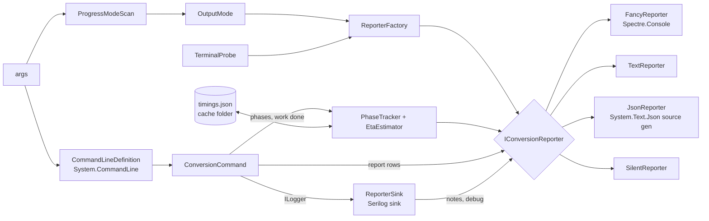

# Console output for people and agents

> Status: **proposed** — the design for plan milestone **M17** ([implementation-plan.md](implementation-plan.md#m17--console-output-for-people-and-agents)),
> decided in [ADR 0077](adr/0077-console-output-modes.md). Nothing here is built yet; [cli.md](cli.md#console-output) describes
> what the converter prints today.

## Goals

1. Say at every moment **which step** of the conversion is running, **how many steps are left**, how far the
   current step is, and **about how long** until the end.
2. Look good to a person at a terminal (Spectre.Console progress bars and tables).
3. Be easy for an AI agent or another program to drive: a stable text format, a JSON format, and a silent mode,
   with **no prompt, menu or wait for input, ever**.
4. Keep the hard constraints: Native AOT with zero warnings on win-x64, linux-x64 and osx-arm64, no reflection, no
   network, `InvariantGlobalization`.

## One switch: `--progress <mode>`

| Mode | For | What it prints |
|---|---|---|
| `fancy` (default) | a person | Spectre.Console: a header, the report as tables, a live progress area (step bar + total bar), conversion notes in color, a timing table, the result. |
| `text` | AI agents | The compact line format below: no color, no animation, one fact per line, stable keywords. |
| `json` | other programs | One JSON object per line (NDJSON) on stdout, schema below. Every message, not just progress. |
| `silent` | scripts that only need the exit code | **Nothing at all**, not even errors or a crash; only the exit code says what happened. `--help` and `--version` still print, because they were asked for. |

There is **no auto mode** (David): the converter never switches mode by itself. `fancy` stays `fancy` when the output
is piped or redirected; Spectre.Console then turns off animation and color codes on its own: tables print as static text and the live
progress area prints nothing, so `fancy` prints one static line per finished step instead (T17.1 spike). An agent passes `--progress text` (or `json`) in its tool declaration.

`--progress silent` is the one exception to "the MOD metadata and the sample table are always printed"
([ADR 0008](adr/0008-report-on-every-conversion.md), superseded in part by ADR 0077). Every other mode prints them.

`--verbose` works in every mode except `silent`: `Debug` detail is dimmed in `fancy`, a `debug` line in `text`, a
`"type":"debug"` object in `json`.

### Streams

| Mode | stdout | stderr |
|---|---|---|
| `fancy` | everything, including conversion notes (one console, so the live area never tears) | the error message, after the live area has closed |
| `text` | every line except `error` | `error` lines |
| `json` | every object, errors included: an agent reads one stream | nothing |
| `silent` | nothing | nothing |

David had no preference; this split is the proposal in ADR 0077.

## Never interactive

- The converter never reads stdin and never calls `AnsiConsole.Prompt`, `Confirm`, `SelectionPrompt` or anything
  else that waits for a key, in any mode. A test runs every mode with stdin closed and a timeout.
- A missing or bad argument (no input file, unknown option, bad value) exits **1** at once with a message that
  names the argument and shows the usage line. In `json` it is one object:
  `{"v":1,"type":"error","code":1,"error":"usage","message":"Required argument missing: <input.mod>","missing":["input"],"usage":"mod2xgm <input.mod> [options]"}`.
- `--progress` is read **before** the rest of the command line (a pre-scan of `args`), so even a parse error comes
  out in the chosen mode, and `silent` stays silent.
- Parsing stays on **System.CommandLine**: it is AOT-safe and already approved. **Spectre.Console.Cli**
  (`CommandApp`) is not used: it binds settings by reflection and is marked not AOT-compatible, which breaks the
  zero-warning AOT rule ([ADR 0077](adr/0077-console-output-modes.md#options-considered)).

## The orchestration layer (`src/Output/`, proposed)



- **`OutputMode`** — `Fancy`, `Text`, `Json`, `Silent`; on `ConversionOptions` as `Progress`.
- **`TerminalProbe`** — reads once: `Console.IsOutputRedirected`, `Console.IsErrorRedirected`, the console width,
  `NO_COLOR`, `TERM=dumb`, and Spectre's detected `Capabilities` (Ansi, Interactive, ColorSystem). It never changes the
  mode; it only configures the `fancy` console, and its findings are logged at `Debug`.
- **`IConversionReporter`** — everything the user sees goes through it:
  `RunStarted`, `Metadata`, `Samples`, `OutputInstruments`, `PhaseStarted`, `PhaseProgress`, `PhaseFinished`, `Note`,
  `Debug`, `Info` (e.g. the XGM2 extension line), `Timings`, `Result`, `Error`. Each takes typed records, never
  preformatted text, so `json` gets fields and `fancy` gets table cells.
- **`ReporterSink`** — a Serilog `ILogEventSink` that hands `Warning` events (conversion notes) and `Debug` events to
  the reporter. Serilog stays the logging pipeline and the 61 stages that take a `ConversionNotes` / `ILogger` do not
  change. The console sink goes away from the converter: nothing writes to the console except the reporter.
- **`PhaseTracker`** — knows the phase list for this run (from the options), the current step, the work done in it,
  and times every phase with `TimeProvider` (a fake clock in tests).
- **`Program.Run`** — creates the reporter first; `ConversionException` → `Error` + its exit code; any other
  exception → `Error` (with the stack trace in `fancy`/`text`/`json`, nothing in `silent`) + exit 5.

## Phases

The steps are known before the first one starts, so "step 5 of 9" is true from the start. Which steps a run has
depends on its options:

| # | Phase (`id`) | When | Work counted |
|---|---|---|---|
| 1 | Check paths (`check`) | always | — (instant) |
| 2 | Read MOD (`read`) | always | bytes |
| 3 | Scan sample use (`scan`) | always | rows played |
| 4 | Build song model (`model`) | always | patterns |
| 5 | Play ticks (`play`) | always | orders |
| 6 | Analyze samples (`analyze`) | `--verbose`, the harness, and (M9) the optimizer | samples |
| 7 | Map channels (`map`) | always | orders |
| 8 | Write DMF (`write`) | a song file is written | — (instant) |
| 9 | Render WAV (`render`) | `--render-wav` | seconds of song rendered |

When the optimizer lands (plan M9) it adds its passes as phases (`fit-fm`, `fit-psg`, `fit-pcm`, `pre-mix`,
`allocate`, `refine`), each counting candidates or rounds; `refine` under `--time-budget` counts time against the
budget, so its bar and estimate are exact.

Stages report work through a small **`IWorkCounter`** parameter (`Total`, `Advance(n)`), with a no-op default so
tests and the harness need not pass one. Counting is cheap (an integer add); the reporter throttles what it shows:
`fancy` redraws at most 10 times a second, `text` writes a progress line at most every 5 s, `json` a progress
object at most once a second, plus every start and end.

## Time estimate

- **Current step:** once a step has done at least 2 % of its work and run for 0.5 s, remaining =
  elapsed × (total − done) / done, smoothed (exponential moving average) so it doesn't jump.
- **Steps not started yet:** from **history**: the seconds per unit of work each phase took on earlier runs, times
  this run's units (known once the earlier steps have run: rows after the scan, seconds of audio after playback).
  A phase with no history counts as unknown.
- **Total:** current remaining + the sum of the estimates for the steps left. When any part is unknown the total is
  shown as `about 12 s+` in `fancy`, `eta=12s+` in `text`, `"eta_s":12,"eta_partial":true` in `json`; with nothing
  known, `—` / `eta=?` / `"eta_s":null`.
- **History file:** `timings.json` at the **root** of the candidate cache folder (`--cache-dir`, default
  [cli.md](cli.md)), outside the per-build folders so it survives new builds. Per phase: an exponential moving
  average of seconds per unit over the last runs, plus the machine's processor count. Written atomically (temp file +
  rename) at the end of a run; a file that can't be read or written is ignored with a `Debug` line, never a failure.
  `--no-cache` neither reads nor writes it, and then only the current step has an estimate. Serialized with a
  `System.Text.Json` source-generated context (AOT-safe).

## `fancy`

- A header rule: `mod2xgm 0.x · song.mod → DMF · quality normal`.
- Report section 1 as a two-column grid, section 2 as a `Table` (the same columns as today, status colored: used,
  unused dim, empty dim, ignored yellow), section 3 as a `Table`.
- Live area (`AnsiConsole.Progress`) with two rows: the step (`[5/9] Map channels`, bar, %, elapsed, remaining) and the
  **total** (`Total`, bar weighted by the time estimates, elapsed, remaining). Instant phases flash through without a
  bar of their own; short pauses use `AnsiConsole.Status` spinners, which Spectre silences when ANSI is off.
- Conversion notes print above the live area in yellow, `Debug` lines dimmed, as they happen (T17.7's spike
  confirms how Spectre takes writes during a live display; if it can't, notes are printed when their step ends).
- End: a timing table (step, time, work), then the result line in green (or the error in red).
- **Escaping:** sample names and the title can hold `[` and `]`, which Spectre markup reads as styles. Names are
  always passed as `Text` objects or through `Markup.Escape`, never interpolated into markup (the same rule as
  Serilog's braces in [cli.md](cli.md#console-report)).

## `text`

One line per fact: a keyword, then `key=value` pairs; values with spaces or quotes are quoted with `\"` escapes;
numbers invariant. Approved shape (David, 2026-11-02):

```
run mod2xgm=0.1.0 input="song.mod" format=dmf quality=normal steps=9
meta file="song.mod" bytes=21802 title="space {debris}" format="ProTracker M.K." channels=4 slots=31 orders=2 restart=127 patterns=2 speed=4 bpm=140
sample 01 "bassdrum" len=4532 loop=- vol=64 fine=0 notes=3 used
sample 03 "  by Jester" len=0 loop=- vol=0 fine=0 notes=0 empty
step 5/9 mapping start | eta 12s
step 5/9 mapping 40% | 3.1s | eta 9s
note: Effect 7xy (tremolo) on channel 2, row 14 dropped
step 5/9 mapping done | 4.0s
output dmf fm=1 psg=1 dac=3 pcm_bytes=13312
output FM 01 <- 01 "lead", 02 "pad" (Sine patch)
time read=0.0s scan=0.1s model=0.0s play=0.4s map=4.0s write=0.1s total=18.2s
result ok exit=0 out=C:\music\song.dmf notes=12 time=18.2s
```

Errors: `error exit=2 message="Input file not found: song.mod"` on stderr. The XGM2 line is printed verbatim as
`info NOTE: SGDK expects XGM2 files to use the .XGM file extension.` so the exact sentence stays in the output.
The keywords and keys are a contract: adding a key is fine, renaming or removing one needs an ADR.

## `json`

NDJSON on stdout, UTF-8, one object per line, every object with `"v":1` (schema version) and `"type"`.
Serialized with `Utf8JsonWriter` / a source-generated `JsonSerializerContext` — no reflection.

| `type` | Fields |
|---|---|
| `run` | `version`, `input`, `format`, `quality`, `steps` (the phase list: `[{"n":1,"id":"check","name":"Check paths"},…]`) |
| `metadata` | `file`, `bytes`, `title`, `tracker`, `tag`, `channels`, `slots`, `orders`, `restart`, `patterns`, `speed`, `bpm` |
| `sample` | `n`, `name`, `length`, `loop_start`, `loop_length`, `volume`, `finetune`, `notes`, `status` |
| `output` | `format`, `fm`, `psg`, `dac`, `pcm_bytes`, `instruments` (`[{"kind":"FM","n":1,"from":[1,2],"detail":"Sine patch"}]`) |
| `phase` | `n`, `of`, `id`, `event` (`start` / `progress` / `end`), `done`, `total`, `elapsed_s`, `eta_s`, `total_eta_s`, `eta_partial` |
| `note` | `message` (rendered), `template`, `properties` (scalar values only) |
| `debug` | `message` |
| `info` | `message` (e.g. the XGM2 extension line, verbatim) |
| `timing` | `phases` (`[{"id":"map","seconds":4.0,"done":2,"unit":"orders"}]`), `total_s` |
| `result` | `exit`, `output`, `wav`, `notes`, `seconds` |
| `error` | `code`, `error` (`usage`, `input-not-found`, `invalid-input`, `output-not-writable`, `internal`, `does-not-fit`), `message`, `missing` (usage errors), `usage`, `stack` (exit 5 only) |

The last line of every run is `result` or `error`. The schema is documented here and checked by a test that
parses every line of every golden run; changing a field's meaning bumps `v`.

## The harness

`tools/Mod2Xgm.Harness` takes the same `--progress` modes (its usage errors keep exit 2). Its phases are per song
(convert, reference render, candidate renders, score, plus the fit passes it was asked for) and one corpus total:
`fancy` shows one row per running job (`--jobs`) plus the corpus bar; `text` / `json` emit the same `step` /
`phase` records with a `song` field. Song times go to the same history file (the harness already uses the
candidate cache folder), so a corpus rerun has an estimate from the start.

## Testing

- Each reporter is tested on recorded event streams: `text` and `json` against golden files
  (`tests/golden/output/`), `fancy` with **Spectre.Console.Testing**'s `TestConsole` (test-only package, fixed width,
  ANSI on and off).
- `silent`: every exit code path (0–6, a crash) prints zero bytes on both streams.
- No prompt: every mode run with stdin closed, under a timeout.
- ETA: `EtaEstimator` and the history file with a fake `TimeProvider`.
- AOT: CI's publish + smoke run executes `--progress fancy`, `text`, `json` and `silent` on all three RIDs.
- Coverage stays ≥ 80 % (AGENTS.md).
