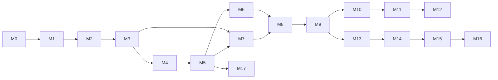

# Implementation plan

> Status: **approved inputs, 2026-10-27.** Milestones are the build order. Each task (`T#.#`) is sized to be
> **one Claude Code PR** on David's PC (.NET 11 SDK available). Update this file when a task lands or the
> plan changes.

## Inputs this plan is built on

| Topic | Decision |
|---|---|
| Goal | Most accurate **sounding** rendition of the MOD ([README.md](README.md#goal)) |
| Standard | **SGDK compliance** — XGM and XGM2 outputs must play through SGDK; a DMF isn't held to their limits ([ADR 0085](adr/0085-target-limits.md)) ([AGENTS.md](../AGENTS.md#sgdk-compliance)) |
| Output order | **DMF**, then XGM2, then XGM (v1) |
| Mapping | **Simple mapper** for the first DMF release, then the **multi-pass optimizer** ([multi-pass.md](multi-pass.md)) |
| In-app rendering/scoring | **Pure C#**: own MOD renderer, ymfm (BSD-3) port for the YM3438, SN76489, PCM driver model |
| Conversion time | Minutes acceptable; `--quality fast\|normal\|best` (default normal, 5-min budget) |
| CH3 special mode | Allowed for DMF (system 0x42) and XGM2; XGM v1 after a probe ROM confirms it (T11.1) |
| SFX | `--reserve-sfx-channels N`, default 0 |
| CLI / logging / tests | System.CommandLine · Serilog (conversion notes at `Warning`) · xUnit v3 |
| Platforms / CI | Windows, Linux, macOS on GitHub Actions; Native AOT artifacts per OS |
| Dependencies | Libraries OK if AOT on all three OSes and permissively licensed; external **applications** only in tests/harness |
| DMF spec gaps | DefleMask manual + Furnace's DMF loader as reference (GPL — read only, never copy) |
| Harness tools (local) | openmpt123, DefleMask WAV/VGM export, SGDK rescomp + BlastEm / Genesis Plus GX |
| PCM budget | None by default; `--max-pcm-bytes` sets one ([ADR 0093](adr/0093-optional-pcm-budget.md), was 128 KB) |
| Build rule | Every warning is an error |
| Report | Metadata + full sample table printed on **every conversion** |

## Definition of done (every task)

1. `dotnet build` and `dotnet test` pass on all three OSes in CI (warnings are errors).
2. New behavior has tests; reader/writer changes have byte-exact tests.
3. Matching docs updated in the same PR; decisions recorded as ADRs in [adr/](adr/README.md).
4. Dependency or reflection-adjacent change → AOT `publish` is clean.
5. User-visible lossy behavior emits conversion notes.
6. Output-format changes keep **SGDK compliance** (checked as each format's milestone defines).

## Milestones

### M0 — Repository foundation
| Task | Work | Acceptance |
|---|---|---|
| T0.1 ✅ | `git init`, `.gitignore` (`.vs/`, `bin/`, `obj/`, `artifacts/`, `*.user`), first commit; create `github.com/davidpizon/Mod2Xgm` (private unless told otherwise) | Repo pushed |
| T0.2 ✅ (PR #1, PR #8) | Move `Mod2Xgm.slnx` to repo root; `Directory.Build.props` (warnings-as-errors/AOT/analysis settings moved out of the csproj); `Directory.Packages.props`; `.editorconfig`; `THIRD-PARTY-NOTICES.md` | `dotnet build` from root; settings apply to all projects |
| T0.3 ✅ (PR #1) | `tests/` folder for test projects; `tests/Mod2Xgm.Tests` (xUnit v3); smoke test | `dotnet test` from root passes |
| T0.4 ✅ (PR #4, PR #6, PR #9) | GitHub Actions matrix (windows/ubuntu/macos): restore, build, test; on tag: AOT publish `win-x64`, `linux-x64`, `osx-arm64`, upload artifacts | Green CI; artifacts on a test tag |
| T0.5 ✅ (PR #1, PR #4) | Update AGENTS.md commands for the new layout | Docs match reality |

### M1 — CLI and logging skeleton
| Task | Work | Acceptance |
|---|---|---|
| T1.1 (PR #10) | System.CommandLine with every option in [cli.md](cli.md) → immutable `ConversionOptions` | Parser tests for every option (`--ignore-samples 3,7,12-14,0x1F`, `128K`/`1M`, `90s`/`5m`, quality, seed, reserve-sfx bounds per format) |
| T1.2 (PR #12) | Exit codes 0–6; output naming; no overwrite without `--force` | CLI tests per exit code |
| T1.3 (PR #14) | Serilog from options (`--verbose` → Debug); `ConversionNotes` → `Warning` | Captured-log tests |
| T1.4 ✅ (CI AOT job: PR #9, PR #10) | AOT publish check with System.CommandLine + Serilog | Clean on all OSes |

### M2 — MOD reader and console report
| Task | Work | Acceptance |
|---|---|---|
| T2.1 (PR #15) | `ModBuilder` test helper (both variants) | Used by reader tests |
| T2.2 (PR #15) | `ModReader`: tags, 31-sample layout, patterns, sample data; reject 6/8-ch (exit 3) | Field tests; corrupt files → exit 3 with offset |
| T2.3 (PR #22) | 15-sample detection (relaxed checks, a conversion note for every sign of junk), loop-in-bytes quirk | Heuristic tests incl. false positives |
| T2.4 (PR #24) | Usage scan: trigger counts following the song flow (`Bxx`/`Dxx`/`E6x`/`F00`, one extra time around a jump back), used/unused/empty | Tests |
| T2.5 (PR #27) | `ModReport` sections 1–2, wired into the **conversion command itself** right after reading | Golden text tests |

### M3 — Song model and playback semantics
| Task | Work | Acceptance |
|---|---|---|
| T3.1 (PR #28) | IR types (`src/Model`) | No MOD types leak |
| T3.2 (PR #29) | Period → note + cents, finetune (ProTracker tables), PAL/NTSC clock; `--input-region` / `--output-region` replace `--region` | Table tests |
| T3.3 (PR #30) | `ModToSong` (notes, instruments, samples) and all ProTracker effects decoded, ProTracker 2 rules (`ModPlayer`) | Per-effect tests |
| T3.3a (PR #31) | `--player protracker\|ust`: the reader, usage scan, report, decoder and `ModToSong` follow one player's rules; default `ust` for 15-sample files, `protracker` otherwise; every run says which player it emulates | Tests per rule and per default |
| T3.3b (later) | `--player openmpt`: OpenMPT's MOD rules, including its per-file guesses (8xx/E8x panning, 7-bit panning, random waves, NoiseTracker `Dxx`; vblank timing with the tick player). Reference: [OpenMPT wiki](https://wiki.openmpt.org/Main_Page) and its BSD-licensed source | Tests per rule |
| T3.4 (PR #32) | Order traversal (`Bxx`, `Dxx`, `E6x`, `EEx`, `Fxx`), loop point, **tick player** (a port of pt2-clone's ProTracker 2 replayer on the raw cells; output: the full picture of every channel on every tick, `Playback`); source tick rate from `--input-region` (50/60 Hz at BPM 125, [cli.md](cli.md#regions)) | Hand-worked test songs now (lengths, loop points, every effect's tick behavior); duration vs openmpt123 ± 1 tick on the corpus joins the harness (T6.3) |

### M4 — Close the DMF spec gaps
| Task | Work | Acceptance |
|---|---|---|
| T4.1 (PR #33) | DefleMask manual + Furnace loader → resolve every **Verify** in [formats/dmf.md](formats/dmf.md), incl. ext. CH3 (0x42) channel layout | No v1 Verify items left |
| T4.2 (PR #34) | Test-only `DmfReader` (`tests/Mod2Xgm.Tests/Dmf`): file versions 24–27, both Genesis systems, strict checks; `DmfBuilder` makes test files in code | Every field and rejection tested on built files and one spelled out byte by byte from the spec; the round trip of writer output is T5.2's test |
| T4.3 (PR #35) | Probe DMFs (FM note, DAC sample, PSG note, custom Hz, ext. CH3), built by `DmfProbes` and kept current by tests, in `tests/golden/dmf-probes/` with a listening checklist; DefleMask "Save As" copies are read back and must hold the same song | David confirms in DefleMask **and** each survives VGM export → rescomp `XGM2` — **done 2026-10-28**, all five pass ([results](../tests/golden/dmf-probes/README.md#results)); found PSG notes sound two octaves up |

### M5 — DMF writer + simple mapper (first playable release)
| Task | Work | Acceptance |
|---|---|---|
| T5.1 ✅ (PR #38) | `SampleProcessor`: high-quality resampling (NWaves; `--resampler smooth\|amiga`), bit depth, loops, trim ([ADR 0038](adr/0038-sample-processor.md)) | Unit + spectral tests |
| T5.2 ✅ (PR #39) | `DmfWriter` (all sections, zlib, one pattern per matrix row per channel; [ADR 0039](adr/0039-dmf-writer.md)) | Byte-exact + round trip through `DmfReader` |
| T5.3 ✅ | `SimpleMapper` → `GenesisPlan` ([ADR 0040](adr/0040-simple-mapper.md)): one-shot samples → DAC (notes from any channel, louder wins a clash), looped → FM from a built-in patch library, noise → PSG; honors `--require-fm` / `--require-dac` / `--require-psg` ([ADR 0041](adr/0041-require-dac-require-psg.md)); adds `--no-dac` | Tests incl. required samples; conversion notes |
| T5.4 ✅ | Timing: tick times, custom Hz, mid-song `Fxx` (`DmfTimingPlanner`, [ADR 0043](adr/0043-dmf-timing.md)) | Duration within 1 % of openmpt123 — checked against the tick player's durations until the harness (T6.3) adds openmpt123 |
| T5.5 ✅ | Effect translation MOD → DMF **and the song grid** (`DmfSongBuilder`, [ADR 0044](adr/0044-dmf-effects-and-song-grid.md)): notes at each sample's measured pitch, Amiga stereo, DAC copies per loudness and start point, noise envelopes, jumps with parts as written | Per-effect tests; effect probes rendered by openmpt123, Furnace and DefleMask and compared |
| T5.6 ✅ | Command line writes the DMF (`DmfSongBuilder` → `DmfWriter`); `--ignore-samples`; report section 3; `--quality fast` path ([ADR 0045](adr/0045-command-line-writes-dmf.md)) | Every conversion logs metadata + full sample table (all formats, with/without `--info`, also when failing after read) |
| T5.7 | Corpus opens/plays in DefleMask; SGDK path check (VGM export → rescomp): all 19 corpus songs open and pass rescomp `XGM2` ([results](../tests/golden/corpus-check/README.md#results)); version 0.1.0; listening sign-off pending | David's sign-off; **0.1.0** |

### M6 — Accuracy harness + shared scoring
| Task | Work | Acceptance |
|---|---|---|
| T6.1 ✅ | Corpus of 10–20 freely licensed MODs; `tests/data/LICENSES.md` ([ADR 0046](adr/0046-mod-corpus.md): 18 Public Domain / CC0 songs from The Mod Archive + a 15-sample song made in code) | Licenses recorded |
| T6.2 ✅ | `src/Scoring` (pure C#, [ADR 0042](adr/0042-scoring-metrics.md)): STFT, multi-resolution log-mel distance, MFCC distance (compared on the corpus; see [references/fm-matching.md](references/fm-matching.md)), onset error, alignment, `SongScorer` | Unit tests on synthetic signals |
| T6.3 ✅ | `tools/Mod2Xgm.Harness` ([harness.md](harness.md), [ADR 0047](adr/0047-accuracy-harness.md)): libopenmpt (openmpt123's engine) reference renders; Furnace renders; ingest DefleMask WAV exports and emulator captures; CSV + markdown report; tick-player durations vs openmpt123 ± 1 tick (moved from T3.4) | Stable scores on reruns |
| T6.4 ✅ | Baseline for the simple mapper ([ADR 0049](adr/0049-simple-mapper-baseline.md), [baseline](../tests/golden/harness-baseline/README.md)): Furnace renders; onset weight 0 after listening; the score agrees only weakly with ears so far | Recorded in an ADR ([adr/](adr/README.md)) |

### M7 — In-app rendering (pure C#)
| Task | Work | Acceptance |
|---|---|---|
| T7.1 ✅ (PR #57) | MOD renderer on the tick player: OpenMPT's clean default sound, measured ([ADR 0054](adr/0054-mod-renderer.md)); notes beyond ProTracker's range as in OpenMPT ([ADR 0055](adr/0055-notes-beyond-protracker-range.md)) | Score vs openmpt123 render below a tight threshold on the corpus: ≤ 1.25 dB log-mel on every song ([harness.md](harness.md#in-app-mod-renderer)) |
| T7.2 ✅ | YM2612 model: C# port of ymfm OPN2 (BSD-3 notice), the YM3438 only ([ADR 0056](adr/0056-ym3438-model.md)) | Matches ymfm reference output on test register streams (bit-exact or within tolerance); vs Nuked-OPN2 (David: replaces the BlastEm captures) |
| T7.3 ✅ | SN76489 model: C# port of MAME's Sega PSG (BSD-3 notice) ([ADR 0057](adr/0057-sn76489-model.md)) | Matches MAME bit-exact on test write streams; vs Nuked-PSG (David: GPL approved for the test tool only) |
| T7.4 ✅ | PCM driver models: DMF DAC, XGM (4 ch, 14 093 Hz), XGM2 (3 ch, 13 317 / 6 658 Hz), as `$2A`/`$2B` streams for the YM3438 ([ADR 0058](adr/0058-pcm-driver-models.md)) | Tests built from the drivers' source (David: captures move to T7.9) |
| T7.5 ✅ | `GenesisRenderer`: plan → stereo WAV through T7.2–T7.4; `--render-wav` and the harness's `genesis` column ([ADR 0059](adr/0059-genesis-renderer.md)) | Renders corpus; performance budget recorded (David: measured, no target) |
| T7.6 ✅ | Close the MOD renderer's known differences from OpenMPT ([ADR 0054](adr/0054-mod-renderer.md#known-differences)): finetune of in-range notes (measured: quarter periods, not 2^(−ft/96)), the first pass of a loop, the wandering offset in `sharpojects_cantpleaseeveryone` (it was finetune); slides, arpeggio and vibrato too ([ADR 0060](adr/0060-openmpt-pitch-and-loops.md)); the `jam_-_*` lead (1-word samples, [ADR 0062](adr/0062-one-word-samples.md)) | Each difference measured against libopenmpt, then fixed or recorded; the corpus's worst log-mel score goes down |
| T7.7 ✅ | Close the YM3438 model's known differences from the chip ([ADR 0056](adr/0056-ym3438-model.md#known-differences-from-the-chip)): the order of the channel's clipping sum, the SSG-EG blip on alternating shapes, operators one slot at a time, detune overflow at the top (not a difference: it was operator 1's late key-on); found on the way, the SSG-EG inverted hold, the key-on sample's envelope step, the envelope timer's wrap and the fast rates' step order ([ADR 0064](adr/0064-ym3438-chip-differences.md)) | Each difference measured against Nuked-OPN2, then fixed or recorded; the port stays bit-exact with ymfm elsewhere; the probes' Nuked bars go down |
| T7.8 ✅ | Close the SN76489 model's known differences from the chip ([ADR 0057](adr/0057-sn76489-model.md#known-differences-from-the-chip)): the volume levels at the quiet end, when a period change takes effect, the noise's timing after a restart, the power-on latch. Done ([ADR 0065](adr/0065-sn76489-chip-differences.md)): the counters and the noise follow Nuked-PSG; the power-on latch stays MAME's (David); the volume levels are Nuked-PSG's, measured from its output, and PSG volumes are picked from them (David, [ADR 0067](adr/0067-psg-volume-levels.md)) | Each difference measured against Nuked-PSG (and its source checked where marked **Verify**), then fixed or recorded; the port stays bit-exact with MAME elsewhere; the probes' Nuked bars go down |
| T7.9 ✅ | Check the PCM driver models against SGDK's real drivers ([ADR 0058](adr/0058-pcm-driver-models.md#known-differences-from-the-drivers)): SGDK's Z80 code run in an emulated Z80 (a reference tool, like `tools/ym3438-reference`) or emulator captures of the SGDK player ROM (T10.2); the beat wobble, the start delay, when `$2B` changes, DefleMask's own DAC export | Each difference measured, then fixed or recorded; the models' tests keep passing or are updated from the measurement. Done ([ADR 0066](adr/0066-pcm-drivers-checked-against-sgdk.md)): SGDK's built drivers on an emulated Z80 (`tools/pcm-driver-reference`); the models now buffer as the drivers do, XGM2 doubles its first 64 beats, XGM slows when it clips; DefleMask's export left for David |
| T7.10 ✅ (PR #64) | The DMF tunes finetuned notes as the tick player does (ADR 0060): the plan's notes take their pitch from the tick player's `Playback` ([ADR 0061](adr/0061-dmf-pitch-from-tick-player.md)); before, the DMF ignored the instrument's finetune | Finetuned FM and DAC notes planned at OpenMPT's pitch (tests); the corpus's `furnace` and `genesis` columns measured before and after |

### M8 — Candidate generation
| Task | Work | Acceptance |
|---|---|---|
| T8.1 ✅ | Sample analysis: percussive/tonal, pitch stability, envelope, spectral envelope per pitch region ([ADR 0068](adr/0068-sample-analysis.md)) | Tests |
| T8.2 ✅ | FM patch library + fitting per [references/fm-matching.md](references/fm-matching.md) ([ADR 0069](adr/0069-fm-patch-fitting.md)): per-algorithm structure search (GA or pruned exhaustive over MULT/DT), then local search over levels and envelopes on the integer grid; deterministic seed; per pitch region | Fitted patches beat library patches on per-instrument error |
| T8.3 ✅ | PSG candidates (tone / noise): a tone at the note, noise at every rate in both modes, the hiss tuned by tone 3, the buzz tuned to the note (plays below the tone range); volumes every 1/60 s; scored like the FM fits; every try marked for room from the notes the song sounds at once ([ADR 0070](adr/0070-psg-candidates.md)) | Tests |
| T8.4 ✅ | PCM variant candidates with costs: a copy per pitch played for DMF, XGM and XGM2, bytes as the cost and the slot and voice caps marked; every combination of half speed, semitones, short loops and trim tail; scored through the PCM driver models with the FM fits' ruler at every pitch; repeated bent notes baked by the MOD renderer ([ADR 0071](adr/0071-pcm-candidates.md)) | Tests |
| T8.5a ✅ | Pre-mixed PCM for repeated overlaps: every group of 2–4 overlapping notes, with offsets, head/tail split, a baked twin for one-shot tails, and byte dedupe ([ADR 0052](adr/0052-pre-mixed-pcm.md), [ADR 0072](adr/0072-pre-mix-candidates.md)); candidates only | Tests; seams measured with the PCM driver model (T7.4); XGM2 tail aliasing verified (rescomp stores every slot's bytes, so tails cost their own); corpus count of voice steals removed |
| T8.5b ✅ | Locked-pair detection (the same start tick and semitone gap every time, David) and CH3 special dual voice (DMF/XGM2): two 2-operator voices, from new algorithm-4 fits and from cut-down T8.2 fits, the closer kept (David); judged together against the MOD mix ([ADR 0073](adr/0073-ch3-locked-pairs.md)); loosened to half of each track's notes together, ±10 cents, eight times or more, lone notes on their own half ([ADR 0076](adr/0076-loose-locked-pairs.md)) | Tests; CH3 never offered for XGM v1 |
| T8.6 ✅ | Candidate cache, `--no-cache`, `--cache-dir`: every kind of candidate (David), per build; FM fits keyed per pitch region's sound, the rest per song file; the harness uses it now, the conversion in M9 ([ADR 0074](adr/0074-candidate-cache.md)) | Rerun is fast and identical |
| T8.7 ✅ | Drop clues per song track (David): how cheap each track is to drop or thin out when the Genesis runs out of channels: a track that only echoes or doubles another, a very quiet one, one buried under louder ones, and **mirrored tracks** (the same notes, one panned left and one right) that can be merged into one voice (David); cutoffs set by A/B listening, and clues are hints M9 must check ([ADR 0084](adr/0084-drop-clues.md)) | Tests; corpus count of each clue |

### M9 — Allocation, consolidation and refinement (optimizer)
| Task | Work | Acceptance |
|---|---|---|
| T9.1 ✅ | Target limits model (FM/CH3/PSG/PCM voices/slots/bytes, `--reserve-sfx-channels`, `--max-pcm-bytes`): `TargetLimits`, each `--format` with its own; XGM's and XGM2's limits never bind a DMF (David), which has all 6 FM channels and no byte limit; XGM2 holds 123 samples ([ADR 0085](adr/0085-target-limits.md)) | Tests per target |
| T9.1b ✅ | Optional PCM budget (David, 2026-11-08): no default `--max-pcm-bytes`, so XGM and XGM2 hold what the format can; a budget is opt-in ([ADR 0093](adr/0093-optional-pcm-budget.md)) | Tests |
| T9.2 ✅ | Capacity check + warning; `--no-consolidate` → exit 6: only recordings count, as the drivers store them, and voices count whatever you'd hear together (David, [ADR 0086](adr/0086-capacity-check.md)) | Tests |
| T9.3 ✅ | Importance scoring; greedy allocation per section; `--require-fm` / `--require-dac` / `--require-psg` as hard constraints: `OptimizerMapper`, turned on with `--mapping optimizer`, with fitted FM, PSG tones and hiss, and recordings at every pitch on every target ([ADR 0087](adr/0087-greedy-allocator.md)) | Always produces a valid plan; required samples never change type; exit 6 when required PCM can't fit |
| T9.3b ✅ | Layering: one MOD note may sound on more than one Genesis voice when that sounds closer, using only voices no note needs and that the CLI doesn't reserve (David). A PSG tone 12 dB down under FM notes stayed; a recording plus PSG noise lost ([ADR 0088](adr/0088-layering.md)) | An ADR; tests; blind survey rounds against the unlayered version next to the original MOD, one change at a time, and the grades decide what stays |
| T9.3c ✅ | A second FM voice under a chord sample, on an FM channel no note needs, behind `--mapping optimizer` (David, for kc's chords). A detuned copy of the first voice, the pair 3 dB down, stayed; a patch fitted to the pair and keeping chords on their side lost ([ADR 0089](adr/0089-fm-layer.md)) | ADR; tests; blind survey rounds decide what stays |
| T9.4a ✅ | Shrinking recordings as allocator moves (David split T9.4 in two, 2026-11-08): pitches that share one copy, fewer loudness copies, XGM2 half speed, look-alike samples merged; dedupe, trim and short loops stay free and always on. Which moves, how far, and whether shrinking comes before moving notes to FM/PSG are chosen by ear: merge, share pitch and share loudness by default, no half speed, two-sided DAC plays centred ([ADR 0091](adr/0091-shrinking-recordings.md)) | Tests; never a wrong pitch by ear; a song that already fits the target gets no move and keeps every note (David, [multi-pass.md](multi-pass.md#idea)); blind survey rounds on XGM2 WAV renders (a smaller `--max-pcm-bytes` where no song overflows) decide what stays |
| T9.4b ✅ | Voice stealing through pre-mixes: an overlap of recordings that needs more PCM voices than the target has is first pre-mixed into one sample ([ADR 0052](adr/0052-pre-mixed-pcm.md), `PreMixer`), before a note moves to FM/PSG or is cut. Done as a rescue after the allocation, on every target and in `--quality fast`: mixes on, tails on, at most 6 dB turned down, chosen by ear in rounds 16–19 ([ADR 0094](adr/0094-pre-mixed-voice-steals.md)) | Tests; blind survey rounds decide what stays |
| T9.4c ✅ | Stable voices (David, 2026-11-08, after round 12): a sound keeps its voice through the song instead of switching between recording, FM and PSG from one section to the next, which moved neon's left pad and was jarring. Any switch counts, not only a change of side. Whether the sound already playing keeps its voice or each instrument picks one voice for the whole song is chosen by ear: tracks choose in one order for the whole song and keep their sound while it has room ([ADR 0092](adr/0092-stable-voices.md)) | Tests; blind survey rounds on XGM2 WAV renders decide; an ADR records the rule |
| T9.4d ✅ | FM confidence, step 1 (David, 2026-11-09: recordings only when FM is clearly worse): per-region features of each fitted patch (the fit's scores; attack, envelope and brightness distances), one confidence per sample weighted by the importance of the notes in each region, from a provisional model on the log-mel distance ([ADR 0096](adr/0096-fm-confidence.md)) | Tests; no plan changes; measured from the render that sets the patch's level, so no extra FM fits |
| T9.4e–T9.4i | Dropped (David, 2026-11-10): ADR 0096's threshold, table and FM-confidence rounds give way to learned prices ([ADR 0098](adr/0098-learned-allocator-costs.md)); the survey tooling (was T9.4g) and perceptual features (was T9.4h) move into T9.4k | — |
| T9.4j ✅ | Listening answers file ([ADR 0097](adr/0097-learned-listening-score.md)): `tests/golden/listening/answers.tsv` and its README; a harness command that remakes a row's clips from its recipe and checks them byte for byte; past either/or answers whose clips today's code remakes exactly (no 1–5 grades, David); a small round of about 5 pairs on half speed for dull samples, logged through it (David) | Tests; the remake check passes on every row; the round is in the file |
| T9.4k1 ✅ | Perceptual features in `src/Scoring` (David split T9.4k in four, 2026-11-10): PEAQ-style noise-to-mask ratio, NSIM on an ERB spectrogram, envelope modulation, harmonicity; in the harness's scores and in `--remake`'s `features.tsv` ([ADR 0100](adr/0100-perceptual-features.md)) | Tests on synthetic signals; at most 20 ms per pitch region; no plan changes |
| T9.4k2 ✅ | Score fit (ADR 0097, [ADR 0101](adr/0101-listening-score-fit.md)): pairwise logistic with L2, chosen on leave-one-song-out checks, on the features from `src/Scoring`; the score reported next to log-mel. `--fit` remakes the clips, fits, and rewrites `src/Scoring/ListeningWeights.cs` itself (David) | Tests; reports "not enough answers" until the answers allow a weight |
| T9.4k3 ✅ | Pair picker for the pairs the model is least sure of ([ADR 0102](adr/0102-pair-picker.md), `--pick`); a round of about 10 pairs it picks (David), logged in the answers file, then the fit run on them: round 21, and the first weights (envelope modulation; 10 of 10 a/b picks left out one song at a time, log-mel 6) | Tests; the round is in the file; the fit's leave-one-song-out numbers reported |
| T9.4k4 | Pretrained-embedding distances (e.g. PANNs, CLAP, CDPAM) tried as features in the harness only, through ONNX Runtime (David); the models kept outside the repository; an ADR for the library | Harness-only; ADR; compared on leave-one-song-out checks |
| T9.4l | Hold-out round and the adoption decision for the learned score (ADR 0097) | An ADR records it |
| T9.4m | Use the learned score in FM fit selection and the allocator's distances (ADR 0097) | Each use checked in a blind round |
| T9.4n | Per-track stems; masking and exposure features from them ([ADR 0098](adr/0098-learned-allocator-costs.md)) | Tests |
| T9.4o | Training data in the harness: one choice changed at a time, plus pairs to check how costs add up (ADR 0098) | Tests; a log-mel dry run changes no plan |
| T9.4p | 100 or more Public Domain / CC0 training songs and their licences (David); price model fitted with leave-one-song-out checks; Δs predicted on the hold-out against the measured Δs (ADR 0098) | Licences recorded; hold-out numbers reported |
| T9.4q | Importance and `RecordingShrinker` driven by the prices behind a rule switch; half speed per sample when priced low (David) (ADR 0098) | Beats the rules on at least 5 hold-out songs over 2 blind rounds (David) |
| T9.5 | Render & refine loop (worst-section re-fit / re-allocate), `--quality` / `--time-budget` / `--seed` | Deterministic; improves corpus score vs greedy |
| T9.6 | Optimizer vs simple mapper on DMF; switch default if better | Decision logged; **0.2.0** |

### M10 — XGM2 writer
| Task | Work | Acceptance |
|---|---|---|
| T10.1 ✅ (PR #118) | `Xgm2Writer` per [formats/xgm.md](formats/xgm.md) (header, SID with end entry, SDAT/FMDAT/PSGDAT, alignment, loop, CH3 commands); `.xgm2` output; extension note. David moved it ahead of T9.4e–T9.6 (2026-11-09); it records `GenesisPlanPlayer`, recordings in 3 dB steps, music PCM at low priority, no CH3 commands until something uses CH3, xgm2tool and rescomp checks where SGDK is installed ([ADR 0099](adr/0099-xgm2-writer-records-the-player.md)) | Byte-exact tests; CLI test asserts the exact line `NOTE: SGDK expects XGM2 files to use the .XGM file extension.` |
| T10.2 | Confirm how SGDK ingests XGM2 data (rescomp documents only VGM input for `XGM2`; check rescomp source; fallback: compiled `.xgc` via `BIN`, or VGM — the extension is not a concern; found in T10.1: rescomp reads a file named `.xgm` as XGM2, [ADR 0099](adr/0099-xgm2-writer-records-the-player.md)). Then `tools/sgdk-player`: minimal SGDK ROM playing the output | Ingestion path decided and logged; probe files play in BlastEm |
| T10.3 | SGDK compliance test: every corpus output is accepted by rescomp and plays | Automated in the harness |
| T10.4 | Harness run; tune optimizer for XGM2 | Scores recorded; **0.3.0** |

### M11 — XGM (v1) writer
| Task | Work | Acceptance |
|---|---|---|
| T11.1 | Probe ROMs for XGM v1 (spec saved: [formats/xgm.txt](formats/xgm.txt)): CH3 special via `$27`, music PCM priority vs SFX, confirm FM6/DAC are off-limits | Results logged; CH3 enabled or ruled out for XGM |
| T11.2 | `XgmWriter` reusing tick player, renderers and optimizer | Byte-exact; plays via rescomp `XGM` |
| T11.3 | Harness run | **0.4.0** |

### M12 — Hardening and release
| Task | Work | Acceptance |
|---|---|---|
| T12.1 | Malformed-input fuzzing (never crash, exit 3) | 10k mutations pass |
| T12.2 | Performance: reader/writer < 1 s; optimizer respects time budget | Benchmarks recorded |
| T12.3 | Root `README.md`, `THIRD-PARTY-NOTICES.md` complete, release workflow | **1.0.0** |

### M13 — MIDI input
Design in [ADR 0048](adr/0048-midi-input.md): MIDI becomes a song with sampled General MIDI instruments from
VSCO-2 CE (CC0, [sgossner/VSCO-2-CE](https://github.com/sgossner/VSCO-2-CE)), then runs through the same optimizer as
a MOD. Programs VSCO-2 CE doesn't cover play on FM alone; hi-hats and ride on PSG noise.

| Task | Work | Acceptance |
|---|---|---|
| T13.1 | `MidiReader` (SMF 0/1/2, RMID, SMPTE division); `docs/formats/midi.md`; report sections 1–2 for MIDI; input detected by content | Tests per event type on files built in code; every text / copyright / track-name event reported |
| T13.2 | Instrument set: map of General MIDI programs and drum keys → VSCO-2 CE samples (root note, velocity range), built from its SFZ maps; programs without a sample → FM, hi-hats and ride → PSG noise; a `tools/` step fetches the pinned VSCO-2 CE commits and prepares the samples used; loading (16/24-bit WAV, stereo → mono, loops for sustained instruments) | Every program and drum key mapped or noted; tests on generated samples |
| T13.3 | `MidiToSong`: grid choice, tempo map, voice splitting, note-off / sustain, controllers → effects | Per-feature tests; every rounding a conversion note |
| T13.4 | Command line converts MIDI to DMF through the optimizer (voice stealing); sample options on MIDI → exit 1 | CLI tests; MIDI corpus opens in DefleMask and passes rescomp |
| T13.5 | Harness for MIDI: MeltySynth + General MIDI SoundFont reference, timing and pitch against the events; freely licensed MIDI corpus | Scores recorded |

### M14 — Multichannel MOD
Design in [ADR 0063](adr/0063-multichannel-mod-xm-it-input.md): the first step toward IT. More channels than the
Genesis has voices, with no new playback rules.

| Task | Work | Acceptance |
|---|---|---|
| T14.1 | `ModReader` accepts `6CHN`, `8CHN`, `xxCH`, `FLT8` (split patterns joined), `CD81`, `OKTA`; tick player and renderer follow how OpenMPT plays them (panning, rules that differ from 4-channel ProTracker), measured with probe MODs; `docs/formats/mod.md` updated | Reader tests per tag; every measured rule recorded; renderer score against libopenmpt within the MOD bar |
| T14.2 | Command line converts multichannel MOD through the optimizer (voice stealing); freely licensed multichannel corpus | Every stolen voice counted in a conversion note; corpus opens in DefleMask and passes rescomp; scores recorded |

### M15 — XM input
Design in [ADR 0063](adr/0063-multichannel-mod-xm-it-input.md): instruments, envelopes and the shared voice engine,
which M16 builds on.

| Task | Work | Acceptance |
|---|---|---|
| T15.1 | `XmReader` → `XmModule` (header, orders, packed patterns, instruments with note → sample map, envelopes, delta-coded 8/16-bit samples); `XmBuilder` test helper; `docs/formats/xm.md` with **Verify** markers; input detected by content; report sections 1–2 for XM (metadata, every sample numbered through the file with its instruments, every instrument name) | Field tests; corrupt files → exit 3 with offset |
| T15.2 | Model: instruments with note → sample map, volume/panning envelopes with loop and sustain, fadeout, auto-vibrato, ping-pong loops, global volume, XM effects and volume column; `XmToSong` | Per-feature tests; no XM types in `src/Model` |
| T15.3 | Shared voice/envelope engine + `XmTickPlayer`, ported from OpenMPT's XM playback rules (own ADR, `THIRD-PARTY-NOTICES.md`); linear and Amiga frequency tables | Probe XMs per effect and envelope feature measured against libopenmpt |
| T15.4 | `ModRenderer`: ping-pong loops, 16-bit samples, envelopes per tick | Renderer score against libopenmpt within the MOD bar on probe XMs |
| T15.5 | Command line converts XM: envelopes on FM (per tick in XGM/XGM2, per row in DMF), PSG volume macros, ping-pong unrolled; sample options numbered and range-checked per file; `--player` / `--input-region` on XM → exit 1; freely licensed XM corpus | CLI tests; corpus opens in DefleMask and passes rescomp; scores recorded |

### M16 — IT input
Design in [ADR 0063](adr/0063-multichannel-mod-xm-it-input.md): New Note Actions emulated, so a pattern channel can
hold several voices.

| Task | Work | Acceptance |
|---|---|---|
| T16.1 | `ItReader` → `ItModule` (header, orders, old and new instrument formats, samples, packed patterns, IT 2.14/2.15 sample decompression, stereo → mono, song message; OpenMPT's extension chunks skipped with a note); `ItBuilder` test helper; `docs/formats/it.md` with **Verify** markers; report sections 1–2 for IT (song message, samples, instruments) | Field tests; compressed samples round-trip through the builder; corrupt files → exit 3 with offset |
| T16.2 | Model: `Playback` voices that may outnumber the song's channels; sustain loops, pitch/filter envelopes, channel volume, IT effects; `ItToSong`; `GenesisPlanPlayer`, renderer and mappers read voices | Per-feature tests; MOD and XM results unchanged |
| T16.3 | `ItTickPlayer` on the shared engine: NNA, duplicate checks and actions, note fade, IT effect rules and compatibility behaviors, ported from OpenMPT; random variation from `--seed`, with a note | Probe ITs per feature measured against libopenmpt |
| T16.4 | `ModRenderer`: IT resonant filter, sustain-loop release | Renderer score against libopenmpt within the MOD bar on probe ITs |
| T16.5 | Command line converts IT: static filter baked into samples, changing filter approximated with a note, default Zxx filter macros only; voice stealing over background voices; sample options and usage errors as for XM; freely licensed IT corpus | CLI tests; corpus opens in DefleMask and passes rescomp; scores recorded |

### M17 — Console output for people and agents
Design in [cli-output.md](cli-output.md), decided in [ADR 0077](adr/0077-console-output-modes.md): one switch,
`--progress fancy|text|json|silent` (default `fancy`), the step and total progress with time estimates, never a
prompt. Needs only M5, so it can run alongside M8–M9; the optimizer (M9) reports its passes through it.

| Task | Work | Acceptance |
|---|---|---|
| T17.1 ✅ | Spike: core **Spectre.Console** (MIT) under Native AOT: `Progress` with custom columns, `Status`, `Table`, writing lines during a live display, behavior with stdout redirected, `NO_COLOR`; Spectre.Console.Cli stays out (not AOT-compatible). If it isn't clean, try the next package (SpProgress, ShellProgressBar, Chuckie.ConsoleProgressBar), then an own renderer. Pin in `Directory.Packages.props`, `THIRD-PARTY-NOTICES.md`, result in ADR 0077 | AOT publish of a throwaway app **with zero warnings** on win-x64, linux-x64, osx-arm64 (CI matrix); findings recorded |
| T17.2 ✅ | `src/Output/`: `--progress` (pre-scanned from `args` so parse errors use the mode), `OutputMode` on `ConversionOptions`, `TerminalProbe`, `IConversionReporter`, reporters as the Serilog sink (console sink removed), `Program.Run` errors through the reporter, `silent`; no stdin reads anywhere; usage errors name the missing argument and print the usage line. Until T17.7 every non-silent mode prints today's lines | `silent` prints 0 bytes on every exit path (0–6, crash); every mode returns with stdin closed under a timeout; usage-error tests per mode |
| T17.3 ✅ | Structured report: `ModReport`, `DmfReport`, `SampleAnalysisReport` attach typed `ReportRow`s (`LockedPairReport` already logs typed scalars); notes keep template + scalar properties; `text` mode in the compact format ([cli-output.md](cli-output.md#text)) incl. the verbatim XGM2 line | Golden `text` runs in `tests/golden/output/`; every report field present; names with `{}`/`[]`/control characters survive |
| T17.4 ✅ | `json` mode: NDJSON schema v1 ([cli-output.md](cli-output.md#json)) written with `Utf8JsonWriter`; error objects (usage with `missing` + `usage`, exit 2–6, exit 5 with `stack`); last line always `result` or `error` | A test parses every line of every golden run against the schema; AOT publish clean |
| T17.5 ✅ | Phases and work: `PhaseTracker` (phase list from the options, step n of N, timing with `TimeProvider`), `IWorkCounter` in the two slow stages, `SampleAnalyzer` and `GenesisRenderer` (no-op default; the fast steps report their size at the end); throttling per mode; timing table / `timing` object | Step counts right for every option mix (`--info`, `--render-wav`, `--verbose`, xgm/xgm2); counters reach their totals; no measurable slowdown on the corpus |
| T17.6 ✅ | Time estimates: `EtaEstimator` (current step after 2 % / 0.5 s, smoothed; later steps from history; partial / unknown shown as such) and `timings.json` at the cache root (atomic write, `--no-cache` off, damaged file ignored with a `Debug` line) | Fake-clock tests; a second corpus run estimates every step before it starts, within 25 % of the real time on the corpus (recorded) |
| T17.7 ✅ | `fancy` mode on Spectre.Console: header, report tables, step + total bars, colored notes above the live area, `Debug` dimmed, timing table, result/error; markup escaping of names; becomes the default | `TestConsole` tests with ANSI on and off and narrow widths; redirected output has no escape codes or animation frames; David's look sign-off at a terminal |
| T17.8 ✅ | Harness: same `--progress` modes; per-song phases, one row per job plus the corpus total, ETA from the shared history; docs ([harness.md](harness.md), [cli.md](cli.md), AGENTS.md required behavior #1) | Harness tests per mode; CI smoke run of the AOT binary in all four modes on all three RIDs |
| T17.9 | **TODO (David, 2026-11-08):** a table of the **input channels**: each one's name, type (FM, DAC, PSG tone, noise, …) and size (for DAC) | In every mode but `silent` ([cli-output.md](cli-output.md)); tests per mode |
| T17.10 | **TODO (David, 2026-11-08), after the XGM2 (M10) and XGM (M11) writers:** a table of the **output channels**: each one's name, type (FM, DAC, PSG tone, noise, …) and size (for DAC); then the file size difference between input and output, in bytes and as a percentage | In every mode but `silent`, for DMF, XGM and XGM2; tests per mode |

## Dependencies

M4 can run in parallel with M3. M7 can start once M3's tick player lands; M8 needs M6 (scoring) and M7 (rendering).
M13 starts once M9 is done ([ADR 0048](adr/0048-midi-input.md)). M14–M16 follow MIDI, each building on the one
before ([ADR 0063](adr/0063-multichannel-mod-xm-it-input.md)); M14 needs only M9, so it could run alongside M13. M17 (console output) needs only M5 and can run alongside
M8–M9 ([ADR 0077](adr/0077-console-output-modes.md)).

## Risks

| Risk | Mitigation |
|---|---|
| DMF spec gaps resolved wrongly | Probe files checked in DefleMask **and** through rescomp (T4.3) |
| Furnace is GPL | Read only; nothing copied; sources noted |
| ymfm port mismatches the real chip | Compare against ymfm reference output and Nuked-OPN2 (T7.2, [ADR 0056](adr/0056-ym3438-model.md)); close the known differences (T7.7) |
| MAME's PSG mismatches the real chip | Compare against MAME and Nuked-PSG (T7.3, [ADR 0057](adr/0057-sn76489-model.md)); close the known differences (T7.8) |
| PCM models built from reading the drivers miss what they really do | Tests from the Z80 source (T7.4, [ADR 0058](adr/0058-pcm-driver-models.md)); check against the real drivers (T7.9) |
| FM fitting quality / speed | Library seeds, per-pitch-region patches, cache, time budget; harness decides |
| Optimizer overfits the metric | Listening checks at each milestone sign-off |
| Conversions get slow | `--quality fast`, time budget, patch cache, profiling in T12.2 |
| DefleMask WAV export may be manual | Harness accepts manual exports |
| A `--max-pcm-bytes` budget forces heavy consolidation | No default budget ([ADR 0093](adr/0093-optional-pcm-budget.md)); allocator weighs error vs cost |
| XGM v1 driver behavior not covered by the spec (CH3 / timers, PCM priority reset) | Probe ROMs in T11.1 before enabling |
| XM/IT tick players differ from libopenmpt | Port OpenMPT's playback rules; probe files per feature (T15.3, T16.3, [ADR 0063](adr/0063-multichannel-mod-xm-it-input.md)) |
| Dense XM/IT songs (many channels, 16-bit samples) far exceed the Genesis | Voice stealing and consolidation, each counted in conversion notes; scores recorded per song so the cost is visible |

## Plan review (outline critique applied)

- Added DMF **probe files** checked in DefleMask *and* through rescomp, so SGDK compliance is verified early.
- Moved the **tick player** into M3: renderers, writers and the optimizer all need it.
- Split in-app **rendering (M7)** from **candidates (M8)** and **allocation (M9)** so each is testable alone.
- **Scoring** lives in `src/Scoring`, shared by harness and optimizer, so "better" means the same in both.
- Kept the **simple mapper** as `--quality fast` and as the optimizer's baseline.
