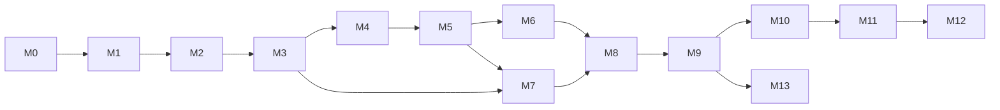

# Implementation plan

> Status: **approved inputs, 2026-10-27.** Milestones are the build order. Each task (`T#.#`) is sized to be
> **one Claude Code PR** on David's PC (.NET 10 SDK available). Update this file when a task lands or the
> plan changes.

## Inputs this plan is built on

| Topic | Decision |
|---|---|
| Goal | Most accurate **sounding** rendition of the MOD ([README.md](README.md#goal)) |
| Standard | **SGDK compliance** — every output must play through SGDK ([AGENTS.md](../AGENTS.md#sgdk-compliance)) |
| Output order | **DMF**, then XGM2, then XGM (v1) |
| Mapping | **Simple mapper** for the first DMF release, then the **multi-pass optimizer** ([multi-pass.md](multi-pass.md)) |
| In-app rendering/scoring | **Pure C#**: own MOD renderer, ymfm (BSD-3) port for YM2612, SN76489, PCM driver model |
| Conversion time | Minutes acceptable; `--quality fast\|normal\|best` (default normal, 5-min budget) |
| CH3 special mode | Allowed for DMF (system 0x42) and XGM2; XGM v1 after a probe ROM confirms it (T11.1) |
| SFX | `--reserve-sfx-channels N`, default 0 |
| CLI / logging / tests | System.CommandLine · Serilog (conversion notes at `Warning`) · xUnit v3 |
| Platforms / CI | Windows, Linux, macOS on GitHub Actions; Native AOT artifacts per OS |
| Dependencies | Libraries OK if AOT on all three OSes and permissively licensed; external **applications** only in tests/harness |
| DMF spec gaps | DefleMask manual + Furnace's DMF loader as reference (GPL — read only, never copy) |
| Harness tools (local) | openmpt123, DefleMask WAV/VGM export, SGDK rescomp + BlastEm / Genesis Plus GX |
| PCM budget | 128 KB per song default |
| Build rule | Every warning is an error |
| Report | Metadata + full sample table printed on **every conversion** |

## Definition of done (every task)

1. `dotnet build` and `dotnet test` pass on all three OSes in CI (warnings are errors).
2. New behavior has tests; reader/writer changes have byte-exact tests.
3. Matching docs updated in the same PR; decisions recorded as ADRs in [adr/](adr/README.md).
4. Dependency or reflection-adjacent change → AOT `publish` is clean.
5. User-visible lossy behavior emits conversion notes.
6. Output-format changes keep **SGDK compliance** (checked as each format's milestone defines).

## Milestones

### M0 — Repository foundation
| Task | Work | Acceptance |
|---|---|---|
| T0.1 ✅ | `git init`, `.gitignore` (`.vs/`, `bin/`, `obj/`, `artifacts/`, `*.user`), first commit; create `github.com/davidpizon/Mod2Xgm` (private unless told otherwise) | Repo pushed |
| T0.2 ✅ (PR #1, PR #8) | Move `Mod2Xgm.slnx` to repo root; `Directory.Build.props` (warnings-as-errors/AOT/analysis settings moved out of the csproj); `Directory.Packages.props`; `.editorconfig`; `THIRD-PARTY-NOTICES.md` | `dotnet build` from root; settings apply to all projects |
| T0.3 ✅ (PR #1) | `tests/` folder for test projects; `tests/Mod2Xgm.Tests` (xUnit v3); smoke test | `dotnet test` from root passes |
| T0.4 ✅ (PR #4, PR #6, PR #9) | GitHub Actions matrix (windows/ubuntu/macos): restore, build, test; on tag: AOT publish `win-x64`, `linux-x64`, `osx-arm64`, upload artifacts | Green CI; artifacts on a test tag |
| T0.5 ✅ (PR #1, PR #4) | Update AGENTS.md commands for the new layout | Docs match reality |

### M1 — CLI and logging skeleton
| Task | Work | Acceptance |
|---|---|---|
| T1.1 (PR #10) | System.CommandLine with every option in [cli.md](cli.md) → immutable `ConversionOptions` | Parser tests for every option (`--ignore-samples 3,7,12-14,0x1F`, `128K`/`1M`, `90s`/`5m`, quality, seed, reserve-sfx bounds per format) |
| T1.2 (PR #12) | Exit codes 0–6; output naming; no overwrite without `--force` | CLI tests per exit code |
| T1.3 (PR #14) | Serilog from options (`--verbose` → Debug); `ConversionNotes` → `Warning` | Captured-log tests |
| T1.4 ✅ (CI AOT job: PR #9, PR #10) | AOT publish check with System.CommandLine + Serilog | Clean on all OSes |

### M2 — MOD reader and console report
| Task | Work | Acceptance |
|---|---|---|
| T2.1 (PR #15) | `ModBuilder` test helper (both variants) | Used by reader tests |
| T2.2 (PR #15) | `ModReader`: tags, 31-sample layout, patterns, sample data; reject 6/8-ch (exit 3) | Field tests; corrupt files → exit 3 with offset |
| T2.3 (PR #22) | 15-sample detection (relaxed checks, a conversion note for every sign of junk), loop-in-bytes quirk | Heuristic tests incl. false positives |
| T2.4 (PR #24) | Usage scan: trigger counts following the song flow (`Bxx`/`Dxx`/`E6x`/`F00`, one extra time around a jump back), used/unused/empty | Tests |
| T2.5 (PR #27) | `ModReport` sections 1–2, wired into the **conversion command itself** right after reading | Golden text tests |

### M3 — Song model and playback semantics
| Task | Work | Acceptance |
|---|---|---|
| T3.1 (PR #28) | IR types (`src/Model`) | No MOD types leak |
| T3.2 (PR #29) | Period → note + cents, finetune (ProTracker tables), PAL/NTSC clock; `--input-region` / `--output-region` replace `--region` | Table tests |
| T3.3 (PR #30) | `ModToSong` (notes, instruments, samples) and all ProTracker effects decoded, ProTracker 2 rules (`ModPlayer`) | Per-effect tests |
| T3.3a (PR #31) | `--player protracker\|ust`: the reader, usage scan, report, decoder and `ModToSong` follow one player's rules; default `ust` for 15-sample files, `protracker` otherwise; every run says which player it emulates | Tests per rule and per default |
| T3.3b (later) | `--player openmpt`: OpenMPT's MOD rules, including its per-file guesses (8xx/E8x panning, 7-bit panning, random waves, NoiseTracker `Dxx`; vblank timing with the tick player). Reference: [OpenMPT wiki](https://wiki.openmpt.org/Main_Page) and its BSD-licensed source | Tests per rule |
| T3.4 (PR #32) | Order traversal (`Bxx`, `Dxx`, `E6x`, `EEx`, `Fxx`), loop point, **tick player** (a port of pt2-clone's ProTracker 2 replayer on the raw cells; output: the full picture of every channel on every tick, `Playback`); source tick rate from `--input-region` (50/60 Hz at BPM 125, [cli.md](cli.md#regions)) | Hand-worked test songs now (lengths, loop points, every effect's tick behavior); duration vs openmpt123 ± 1 tick on the corpus joins the harness (T6.3) |

### M4 — Close the DMF spec gaps
| Task | Work | Acceptance |
|---|---|---|
| T4.1 (PR #33) | DefleMask manual + Furnace loader → resolve every **Verify** in [formats/dmf.md](formats/dmf.md), incl. ext. CH3 (0x42) channel layout | No v1 Verify items left |
| T4.2 (PR #34) | Test-only `DmfReader` (`tests/Mod2Xgm.Tests/Dmf`): file versions 24–27, both Genesis systems, strict checks; `DmfBuilder` makes test files in code | Every field and rejection tested on built files and one spelled out byte by byte from the spec; the round trip of writer output is T5.2's test |
| T4.3 (PR #35) | Probe DMFs (FM note, DAC sample, PSG note, custom Hz, ext. CH3), built by `DmfProbes` and kept current by tests, in `tests/golden/dmf-probes/` with a listening checklist; DefleMask "Save As" copies are read back and must hold the same song | David confirms in DefleMask **and** each survives VGM export → rescomp `XGM2` — **done 2026-10-28**, all five pass ([results](../tests/golden/dmf-probes/README.md#results)); found PSG notes sound two octaves up |

### M5 — DMF writer + simple mapper (first playable release)
| Task | Work | Acceptance |
|---|---|---|
| T5.1 ✅ (PR #38) | `SampleProcessor`: high-quality resampling (NWaves; `--resampler smooth\|amiga`), bit depth, loops, trim ([ADR 0038](adr/0038-sample-processor.md)) | Unit + spectral tests |
| T5.2 ✅ (PR #39) | `DmfWriter` (all sections, zlib, one pattern per matrix row per channel; [ADR 0039](adr/0039-dmf-writer.md)) | Byte-exact + round trip through `DmfReader` |
| T5.3 ✅ | `SimpleMapper` → `GenesisPlan` ([ADR 0040](adr/0040-simple-mapper.md)): one-shot samples → DAC (notes from any channel, louder wins a clash), looped → FM from a built-in patch library, noise → PSG; honors `--require-fm` / `--require-dac` / `--require-psg` ([ADR 0041](adr/0041-require-dac-require-psg.md)); adds `--no-dac` | Tests incl. required samples; conversion notes |
| T5.4 ✅ | Timing: tick times, custom Hz, mid-song `Fxx` (`DmfTimingPlanner`, [ADR 0043](adr/0043-dmf-timing.md)) | Duration within 1 % of openmpt123 — checked against the tick player's durations until the harness (T6.3) adds openmpt123 |
| T5.5 ✅ | Effect translation MOD → DMF **and the song grid** (`DmfSongBuilder`, [ADR 0044](adr/0044-dmf-effects-and-song-grid.md)): notes at each sample's measured pitch, Amiga stereo, DAC copies per loudness and start point, noise envelopes, jumps with parts as written | Per-effect tests; effect probes rendered by openmpt123, Furnace and DefleMask and compared |
| T5.6 ✅ | Command line writes the DMF (`DmfSongBuilder` → `DmfWriter`); `--ignore-samples`; report section 3; `--quality fast` path ([ADR 0045](adr/0045-command-line-writes-dmf.md)) | Every conversion logs metadata + full sample table (all formats, with/without `--info`, also when failing after read) |
| T5.7 | Corpus opens/plays in DefleMask; SGDK path check (VGM export → rescomp): all 19 corpus songs open and pass rescomp `XGM2` ([results](../tests/golden/corpus-check/README.md#results)); version 0.1.0; listening sign-off pending | David's sign-off; **0.1.0** |

### M6 — Accuracy harness + shared scoring
| Task | Work | Acceptance |
|---|---|---|
| T6.1 ✅ | Corpus of 10–20 freely licensed MODs; `tests/data/LICENSES.md` ([ADR 0046](adr/0046-mod-corpus.md): 18 Public Domain / CC0 songs from The Mod Archive + a 15-sample song made in code) | Licenses recorded |
| T6.2 ✅ | `src/Scoring` (pure C#, [ADR 0042](adr/0042-scoring-metrics.md)): STFT, multi-resolution log-mel distance, MFCC distance (compared on the corpus; see [references/fm-matching.md](references/fm-matching.md)), onset error, alignment, `SongScorer` | Unit tests on synthetic signals |
| T6.3 ✅ | `tools/Mod2Xgm.Harness` ([harness.md](harness.md), [ADR 0047](adr/0047-accuracy-harness.md)): libopenmpt (openmpt123's engine) reference renders; Furnace renders; ingest DefleMask WAV exports and emulator captures; CSV + markdown report; tick-player durations vs openmpt123 ± 1 tick (moved from T3.4) | Stable scores on reruns |
| T6.4 ✅ | Baseline for the simple mapper ([ADR 0049](adr/0049-simple-mapper-baseline.md), [baseline](../tests/golden/harness-baseline/README.md)): Furnace renders; onset weight 0 after listening; the score agrees only weakly with ears so far | Recorded in an ADR ([adr/](adr/README.md)) |

### M7 — In-app rendering (pure C#)
| Task | Work | Acceptance |
|---|---|---|
| T7.1 ✅ (PR #57) | MOD renderer on the tick player: OpenMPT's clean default sound, measured ([ADR 0054](adr/0054-mod-renderer.md)); notes beyond ProTracker's range as in OpenMPT ([ADR 0055](adr/0055-notes-beyond-protracker-range.md)) | Score vs openmpt123 render below a tight threshold on the corpus: ≤ 1.25 dB log-mel on every song ([harness.md](harness.md#in-app-mod-renderer)) |
| T7.2 | YM2612 model: C# port of ymfm OPN2 (BSD-3 notice) | Matches ymfm reference output on test register streams (bit-exact or within tolerance); vs BlastEm captures |
| T7.3 | SN76489 model | Tests vs reference captures |
| T7.4 | PCM driver models: DMF DAC, XGM (4 ch ~14 kHz), XGM2 (3 ch 13.3/6.65 kHz) | Tests vs emulator captures |
| T7.5 | `GenesisRenderer`: plan → stereo WAV through T7.2–T7.4 | Renders corpus; performance budget recorded |
| T7.6 | Close the MOD renderer's known differences from OpenMPT ([ADR 0054](adr/0054-mod-renderer.md#known-differences)): finetune of in-range notes (2^(−ft/96)), the first pass of a loop, the wandering offset in `sharpojects_cantpleaseeveryone` | Each difference measured against libopenmpt, then fixed or recorded; the corpus's worst log-mel score goes down |

### M8 — Candidate generation
| Task | Work | Acceptance |
|---|---|---|
| T8.1 | Sample analysis: percussive/tonal, pitch stability, envelope, spectral envelope per pitch region | Tests |
| T8.2 | FM patch library + fitting per [references/fm-matching.md](references/fm-matching.md): per-algorithm structure search (GA or pruned exhaustive over MULT/DT), then local search over levels and envelopes on the integer grid; deterministic seed; per pitch region | Fitted patches beat library patches on per-instrument error |
| T8.3 | PSG candidates (tone / noise) | Tests |
| T8.4 | PCM variant candidates with costs | Tests |
| T8.5 | Locked-pair detection and CH3 special dual voice (DMF/XGM2); pre-mixed PCM for repeated overlaps, with offsets, head/tail split and byte dedupe ([ADR 0052](adr/0052-pre-mixed-pcm.md)) | Tests; CH3 never offered for XGM v1; seams measured with the PCM driver model (T7.4); XGM2 tail aliasing verified; corpus count of voice steals removed |
| T8.6 | Fitted-patch cache (sample hash → patches), `--no-cache` | Rerun is fast and identical |

### M9 — Allocation, consolidation and refinement (optimizer)
| Task | Work | Acceptance |
|---|---|---|
| T9.1 | Target limits model (FM/CH3/PSG/PCM voices/slots/bytes, `--reserve-sfx-channels`, `--max-pcm-bytes`) | Tests per target |
| T9.2 | Capacity check + warning; `--no-consolidate` → exit 6 | Tests |
| T9.3 | Importance scoring; greedy allocation per section; `--require-fm` / `--require-dac` / `--require-psg` as hard constraints | Always produces a valid plan; required samples never change type; exit 6 when required PCM can't fit |
| T9.4 | Consolidation moves (dedupe, trim, pitch quantize, half rate, merge, mid-song swap, voice stealing) as allocator moves | Tests; never a wrong pitch |
| T9.5 | Render & refine loop (worst-section re-fit / re-allocate), `--quality` / `--time-budget` / `--seed` | Deterministic; improves corpus score vs greedy |
| T9.6 | Optimizer vs simple mapper on DMF; switch default if better | Decision logged; **0.2.0** |

### M10 — XGM2 writer
| Task | Work | Acceptance |
|---|---|---|
| T10.1 | `Xgm2Writer` per [formats/xgm.md](formats/xgm.md) (header, SID with end entry, SDAT/FMDAT/PSGDAT, alignment, loop, CH3 commands); `.xgm2` output; extension note | Byte-exact tests; CLI test asserts the exact line `NOTE: SGDK expects XGM2 files to use the .XGM file extension.` |
| T10.2 | Confirm how SGDK ingests XGM2 data (rescomp documents only VGM input for `XGM2`; check rescomp source; fallback: compiled `.xgc` via `BIN`, or VGM — the extension is not a concern). Then `tools/sgdk-player`: minimal SGDK ROM playing the output | Ingestion path decided and logged; probe files play in BlastEm |
| T10.3 | SGDK compliance test: every corpus output is accepted by rescomp and plays | Automated in the harness |
| T10.4 | Harness run; tune optimizer for XGM2 | Scores recorded; **0.3.0** |

### M11 — XGM (v1) writer
| Task | Work | Acceptance |
|---|---|---|
| T11.1 | Probe ROMs for XGM v1 (spec saved: [formats/xgm.txt](formats/xgm.txt)): CH3 special via `$27`, music PCM priority vs SFX, confirm FM6/DAC are off-limits | Results logged; CH3 enabled or ruled out for XGM |
| T11.2 | `XgmWriter` reusing tick player, renderers and optimizer | Byte-exact; plays via rescomp `XGM` |
| T11.3 | Harness run | **0.4.0** |

### M12 — Hardening and release
| Task | Work | Acceptance |
|---|---|---|
| T12.1 | Malformed-input fuzzing (never crash, exit 3) | 10k mutations pass |
| T12.2 | Performance: reader/writer < 1 s; optimizer respects time budget | Benchmarks recorded |
| T12.3 | Root `README.md`, `THIRD-PARTY-NOTICES.md` complete, release workflow | **1.0.0** |

### M13 — MIDI input
Design in [ADR 0048](adr/0048-midi-input.md): MIDI becomes a song with sampled General MIDI instruments from
VSCO-2 CE (CC0, [sgossner/VSCO-2-CE](https://github.com/sgossner/VSCO-2-CE)), then runs through the same optimizer as
a MOD. Programs VSCO-2 CE doesn't cover play on FM alone; hi-hats and ride on PSG noise.

| Task | Work | Acceptance |
|---|---|---|
| T13.1 | `MidiReader` (SMF 0/1/2, RMID, SMPTE division); `docs/formats/midi.md`; report sections 1–2 for MIDI; input detected by content | Tests per event type on files built in code; every text / copyright / track-name event reported |
| T13.2 | Instrument set: map of General MIDI programs and drum keys → VSCO-2 CE samples (root note, velocity range), built from its SFZ maps; programs without a sample → FM, hi-hats and ride → PSG noise; a `tools/` step fetches the pinned VSCO-2 CE commits and prepares the samples used; loading (16/24-bit WAV, stereo → mono, loops for sustained instruments) | Every program and drum key mapped or noted; tests on generated samples |
| T13.3 | `MidiToSong`: grid choice, tempo map, voice splitting, note-off / sustain, controllers → effects | Per-feature tests; every rounding a conversion note |
| T13.4 | Command line converts MIDI to DMF through the optimizer (voice stealing); sample options on MIDI → exit 1 | CLI tests; MIDI corpus opens in DefleMask and passes rescomp |
| T13.5 | Harness for MIDI: MeltySynth + General MIDI SoundFont reference, timing and pitch against the events; freely licensed MIDI corpus | Scores recorded |

## Dependencies

M4 can run in parallel with M3. M7 can start once M3's tick player lands; M8 needs M6 (scoring) and M7 (rendering).
M13 starts once M9 is done ([ADR 0048](adr/0048-midi-input.md)).

## Risks

| Risk | Mitigation |
|---|---|
| DMF spec gaps resolved wrongly | Probe files checked in DefleMask **and** through rescomp (T4.3) |
| Furnace is GPL | Read only; nothing copied; sources noted |
| ymfm port mismatches the real chip | Compare against ymfm reference output and BlastEm/GPGX captures (T7.2) |
| FM fitting quality / speed | Library seeds, per-pitch-region patches, cache, time budget; harness decides |
| Optimizer overfits the metric | Listening checks at each milestone sign-off |
| Conversions get slow | `--quality fast`, time budget, patch cache, profiling in T12.2 |
| DefleMask WAV export may be manual | Harness accepts manual exports |
| 128 KB budget forces heavy consolidation | Allocator weighs error vs cost; `--max-pcm-bytes` |
| XGM v1 driver behavior not covered by the spec (CH3 / timers, PCM priority reset) | Probe ROMs in T11.1 before enabling |

## Plan review (outline critique applied)

- Added DMF **probe files** checked in DefleMask *and* through rescomp, so SGDK compliance is verified early.
- Moved the **tick player** into M3: renderers, writers and the optimizer all need it.
- Split in-app **rendering (M7)** from **candidates (M8)** and **allocation (M9)** so each is testable alone.
- **Scoring** lives in `src/Scoring`, shared by harness and optimizer, so "better" means the same in both.
- Kept the **simple mapper** as `--quality fast` and as the optimizer's baseline.
